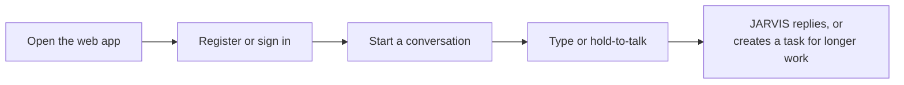
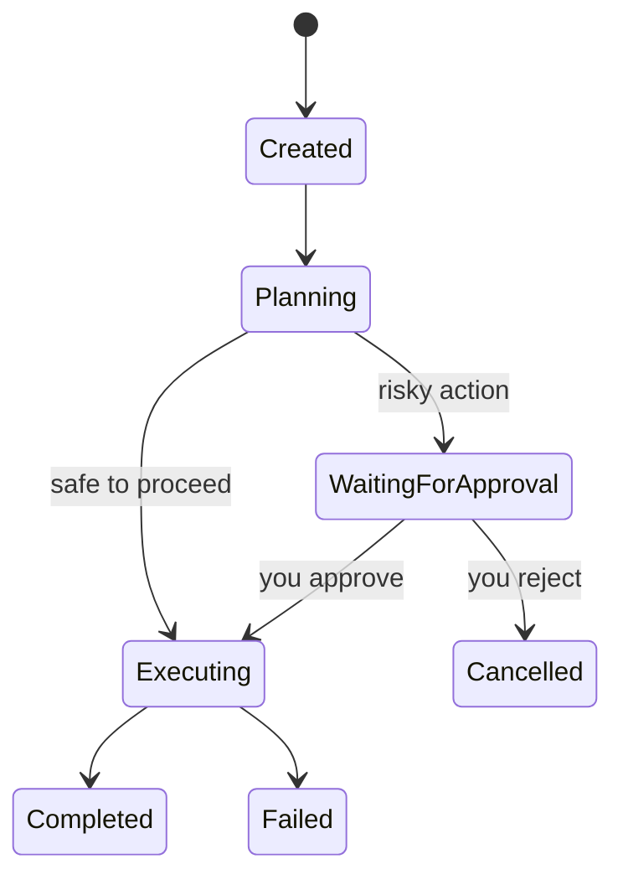

# JARVIS — User Guide

**Author**: Abhishek Pandey
**Last Updated**: 2026-11-16

JARVIS runs entirely in your browser. There is nothing to install on your
Mac, iPhone, or iPad — open the web app, sign in, and everything happens on
JARVIS's cloud infrastructure.

## Getting started

### Creating an account

Open the web app and register with an email and password. Sign-in issues two
credentials behind the scenes: a short-lived access token that authorizes your
requests, and a longer-lived refresh token stored in the HttpOnly cookie
`jarvis_refresh` (path `/api/v1/auth`) that keeps you signed in. You do not
need to think about either — closing the tab signs you out of the active
session; the refresh cookie brings you back without re-entering your password
within its 30-day window. The cookie is marked `Secure` only when the
deployment sets `APP_ENV=production`. Local development leaves that flag off
so the cookie works on `http://localhost`.

The browser talks to the API at `http://localhost:8000` unless the page was
built with a different `NEXT_PUBLIC_API_URL`. The API accepts credentialed
requests only from `http://localhost:3000`. A page opened on another origin,
including the local Kubernetes web port `3001`, is refused by that CORS rule.

### Starting a conversation

Click to start a new conversation and type a message. Replies stream in as
they are generated. If no AI model is configured on this deployment, JARVIS
tells you plainly rather than guessing — see
[When no AI model is configured](#when-no-ai-model-is-configured) below.

## Talking instead of typing

Hold the microphone control to speak, release it to stop. JARVIS listens in
English or Hindi — switch languages with the control next to the microphone
button. Your words are transcribed by your browser, not sent anywhere as audio.

If your browser does not support speech recognition, the microphone control is
unavailable and you type instead — this is a graceful fallback, not an error.

JARVIS can read a reply aloud using your browser's own speech synthesis. Typed
messages are never read aloud automatically; only a voice-submitted exchange is.

## Tasks versus chat replies

Not everything you ask for is a quick reply. Some requests become a **task**:
an item JARVIS works on in the background and reports back on, even after you
close the browser.

If a task involves something sensitive — sending an email, deleting a
document, spending money, changing a permission, publishing, or deploying —
JARVIS stops and asks for your explicit approval before doing it. Approval
applies to that exact action; if the action would change, JARVIS asks again
rather than reusing an old approval.

Closing your browser does not cancel a task in progress. Reopen JARVIS on any
device and it will have continued, or already finished.

## Memory

JARVIS can remember things about you across conversations — preferences,
ongoing projects, decisions you've made. Nothing becomes a memory
automatically just because you mentioned it; JARVIS proposes a memory and you
confirm it, or you explicitly tell it to remember something. You can mark a
memory as sensitive, which keeps it out of reach of any assistant capability
that does not need it.

## Using JARVIS from another device

Sign in on a second device and your conversations, tasks, and memories are all
there — there is no separate sync step, because everything lives on the
server, not on your device.

### Registering and removing devices

JARVIS can track which devices you use it from (web, phone, desktop) for your
own reference. If a device is lost or no longer yours, remove it from your
account settings — a request naming a removed device is rejected.

## Connecting Gmail and Google Calendar

From your account's integrations page, you can connect Gmail and Google
Calendar so JARVIS can read a short summary (your Gmail address and message
count, or your calendar count) as part of planning a task. This is separate
from "Siri and Google Assistant" below — it is JARVIS reading your Google
account, not a voice assistant.

Connecting sends you to Google's own consent screen at
`https://accounts.google.com`. The local default return address is
`http://localhost:3000/`. If the integration isn't available yet on this
deployment, JARVIS tells you it isn't configured rather than showing a broken
button. Disconnecting deletes the stored access token immediately; JARVIS
cannot read your Gmail or Calendar again until you reconnect. The consent
request asks only to read mail and read calendars. JARVIS cannot send mail or
change a calendar event with the current connection.

## Siri and Google Assistant

If you've connected a command from Siri or Google Assistant (where supported),
it reaches the same JARVIS behind the scenes — the same task planner, the same
approval rules, the same memory.

### When no AI model is configured

Some JARVIS deployments do not have a model provider configured yet. In that
case:

- If you're asking something conversational through Siri or Google Assistant,
  JARVIS hands the request back to your device's own assistant rather than
  guessing at an answer — you'll see a note explaining that, and your phone's
  own Siri or Assistant responds instead.
- If you're asking through the web app or typing, JARVIS tells you plainly
  that no model is configured, instead of inventing a reply.
- A request that just needs JARVIS to do something concrete (not answer a
  question) still works and is queued as a task, because that path does not
  need a language model to understand a clear instruction.

This is intentional: JARVIS never fabricates an answer it cannot actually
produce.

## What JARVIS cannot do (and won't pretend to)

Because JARVIS runs entirely in the cloud with nothing installed on your
device, some things are genuinely out of reach rather than simply unbuilt:

| You might expect | What actually happens |
|---|---|
| "Hey JARVIS" always listening | Not possible from a browser tab without you holding the microphone button first |
| JARVIS controlling apps on your Mac or iPhone directly | Not possible — JARVIS has no access to your local device; it works through its own cloud browser and connected accounts instead |
| JARVIS reading files from your computer | Not possible — connect a cloud drive (Google Drive, OneDrive) instead |
| Guaranteed push notifications on iPhone | Web push on iOS requires adding JARVIS to your Home Screen; otherwise you'll see in-app notifications and, if configured, email |

If something doesn't work the way you expect, JARVIS will say so rather than
silently doing something else.

## Troubleshooting

| Symptom | What's happening |
|---|---|
| "No model provider is configured" when chatting | This deployment has no AI credential set up yet; tasks and structured commands still work |
| Microphone button is missing | Your browser doesn't support speech recognition; type instead |
| A task is stuck "waiting for approval" | Open the task and approve or reject the specific action it's asking about |
| Signed out unexpectedly | Your session may have been revoked (for example, after a password change) or your refresh cookie expired after 30 days — sign in again |
| A device you removed can still see old data | Removing a device blocks new commands from it; it does not retroactively undo anything that device already did |
