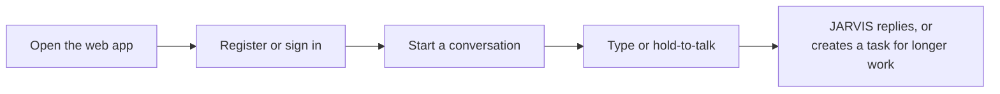
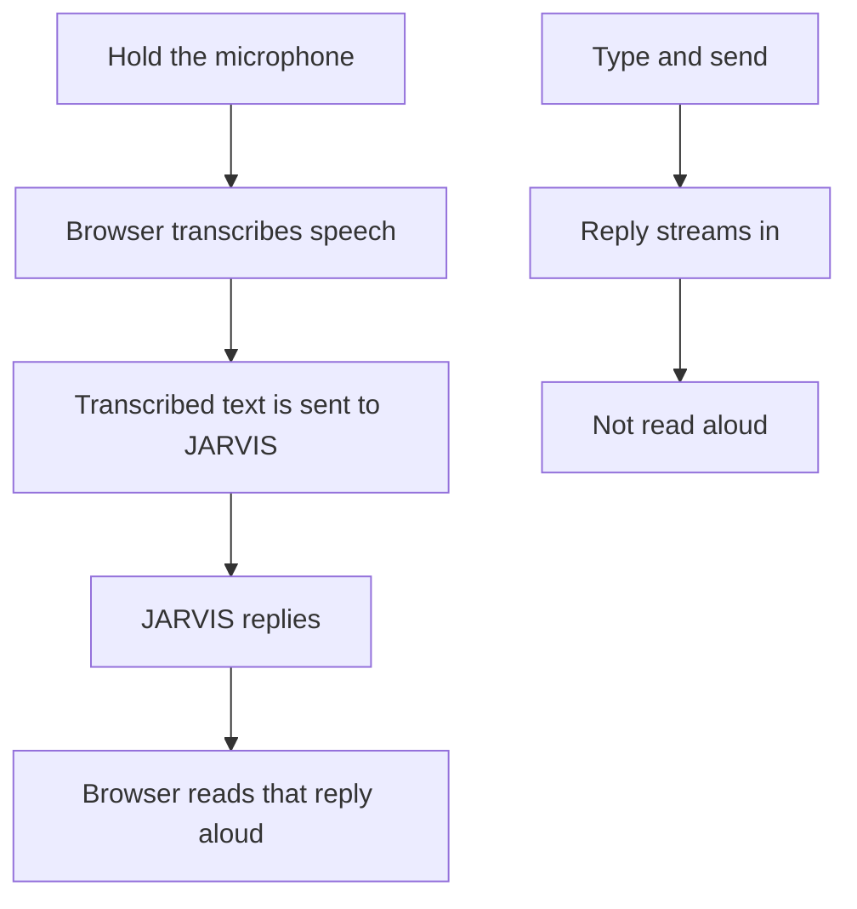
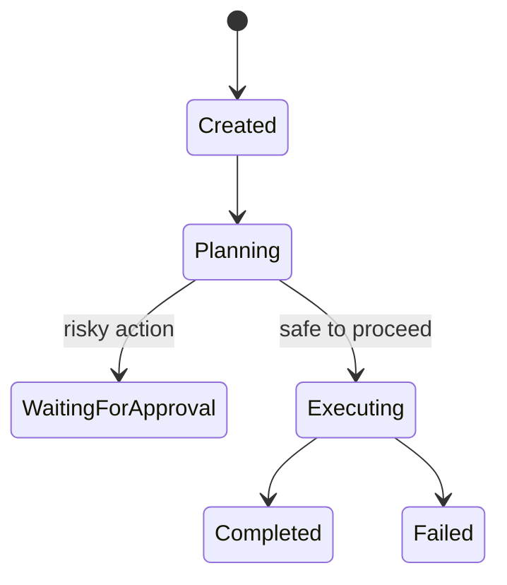
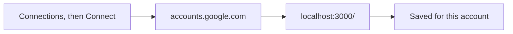
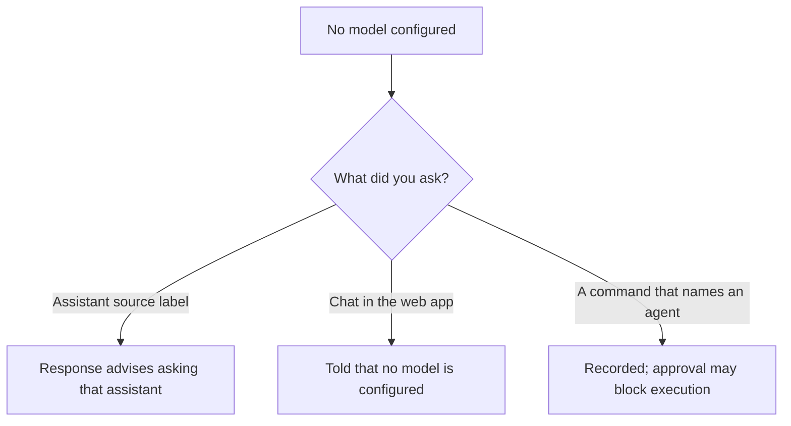

# JARVIS — User Guide

**Author**: Abhishek Pandey
**Last Updated**: 2026-11-16

JARVIS is accessed through your browser; there is nothing to install on your
Mac, iPhone, or iPad. The API and worker run on JARVIS's infrastructure.

## Getting started

### Creating an account

Open the web app and register with an email and password. Sign-in issues a
short-lived access token stored in the tab's `sessionStorage` and a longer-lived
refresh token in the HttpOnly `jarvis_refresh` cookie (path `/api/v1/auth`).
Although the cookie can persist for 30 days, the web client does not call the
refresh endpoint or renew access tokens automatically. Closing the tab clears
the access token; opening the app again does not restore the session
automatically, so sign in again. The cookie is marked `Secure` only when the
deployment sets `APP_ENV=production`. Local development leaves that flag off
so the cookie works on `http://localhost`.

The browser talks to the API at `http://localhost:8000` unless the page was
built with a different `NEXT_PUBLIC_API_URL`. The API accepts credentialed
requests only from `http://localhost:3000`. A page opened on another origin,
including the local Kubernetes web port `3001`, is refused by that CORS rule.

### Starting a conversation

Click to start a new conversation and type a message. Replies stream in as
they are generated. If no AI model is configured on this deployment, JARVIS
tells you plainly rather than guessing — see
[When no AI model is configured](#when-no-ai-model-is-configured) below.

## Talking instead of typing

Hold the microphone control to speak, release it to stop. JARVIS listens in
English or Hindi — switch languages with the control next to the microphone
button. Speech recognition uses the browser's Web Speech API. Browser and
recognition-provider behavior varies; some browsers may send audio to a remote
recognition service. JARVIS cannot guarantee that audio stays on-device or is
not sent elsewhere. See [MDN's SpeechRecognition documentation](https://developer.mozilla.org/en-US/docs/Web/API/SpeechRecognition).

If your browser does not support speech recognition, the microphone control is
unavailable and you type instead. JARVIS reads a reply aloud using browser-side
speech synthesis. Typed messages are not read aloud automatically.

## Tasks versus chat replies

Not everything you ask for is a quick reply. Some requests become a **task**:
a record of requested work. Queued tasks run in the background, even if you
close the browser. The worker currently has real handlers only for limited
Google profile-total and Calendar-list reads; other agent steps can finish with
a placeholder result without carrying out the requested action. A task marked
completed is not proof that an unimplemented capability was performed.

A plan classified as requiring approval is stored with status
`waiting_for_approval` and no job is created. The current API has no approval
or rejection endpoint, so the task does not proceed. A cancel request for a
task with no active job currently returns HTTP 409 (`No active job to cancel`).

Closing your browser does not cancel a task that already has a queued or
running job. The worker continues independently of the browser.

## Memory

JARVIS can store account memories and include them in model context. The web
UI has no controls to view, edit, or delete memories. The API accepts a
`sensitive` label, but it does not exclude memories from model context. Do not
store sensitive information on the assumption that the label protects it.

## Using JARVIS from another device

Sign in on another device to access the same account's conversation history.
Account data is stored on the server, so no separate sync step is needed.

### Device management (API only)

The API supports device registration, listing, and revocation. The web UI has
no device-management controls.

## Connecting Gmail and Google Calendar

The integrations page supports Google Gmail and Google Calendar. Gmail access
reads profile totals, not email content. Calendar access reads the calendar
list, not event content. The connections are read-only; JARVIS cannot send
email or write calendar events. These are Google account connections, not
voice-assistant integrations.

Connecting sends you to Google's own consent screen at
`https://accounts.google.com`. The local default return address is
`http://localhost:3000/`. If the integration isn't available yet on this
deployment, JARVIS tells you it isn't configured rather than showing a broken
button. Disconnecting deletes the stored access token immediately; JARVIS
cannot read your Gmail or Calendar again until you reconnect. The consent
request asks only to read mail and read calendars. JARVIS cannot send mail or
change a calendar event with the current connection.

## Siri and Google Assistant

There is no native Siri or Google Assistant integration. `siri` and
`google_assistant` are API source labels, not connected assistants. A handoff
response only advises you to continue with the named device assistant; JARVIS
does not invoke it.

### When no AI model is configured

Some JARVIS deployments do not have a model provider configured yet. In that
case:

- For a command submitted with the `siri` or `google_assistant` source label,
  JARVIS can return a message advising you to ask that assistant. It does not
  invoke the assistant or send the request back to it.
- If you're asking through the web app or typing, JARVIS tells you plainly
  that no model is configured, instead of inventing a reply.
- A command that names a JARVIS agent can be recorded as a task without a
  model. That does not mean the requested work is implemented: except for the
  limited Google read handlers, agent steps can return a placeholder completion
  without doing the requested action. If its plan requires approval, it is
  stored without a job and does not execute. A vague request is not queued.

This is intentional: JARVIS never fabricates an answer it cannot actually
produce.

## What JARVIS cannot do (and won't pretend to)

Because JARVIS runs entirely in the cloud with nothing installed on your
device, some things are genuinely out of reach rather than simply unbuilt:

| You might expect | What actually happens |
|---|---|
| "Hey JARVIS" always listening | Not available; hold the microphone button to start speech recognition |
| JARVIS controlling apps or reading files on your device | Not available; JARVIS has no local-device access |
| Cloud browser, filesystem, or cloud-drive access | Not available; there is no cloud browser, filesystem, or drive integration |
| Notifications outside JARVIS | Notifications appear in the app; any browser notification is local to the open app, not server push. There is no email delivery or server push |

If something doesn't work the way you expect, JARVIS will say so rather than
silently doing something else.

## Troubleshooting

| Symptom | What's happening |
|---|---|
| "No model provider is configured" when chatting | Some clear instructions can be recorded as tasks without a model; approval-gated plans have no job and do not execute |
| Microphone button is missing | Your browser doesn't support speech recognition; type instead |
| A task is stuck "waiting for approval" | The current API has no approve/reject endpoint and creates no job for this status; the task cannot proceed. A cancel request returns HTTP 409 when there is no active job |
| Signed out after closing the tab | The refresh cookie does not automatically restore the access token; sign in again |
| A device you removed can still see old data | Removing a device blocks new commands from it; it does not retroactively undo anything that device already did |
