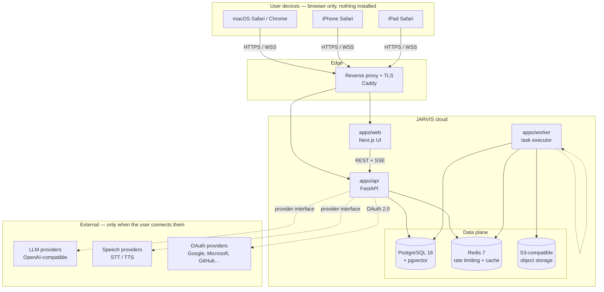
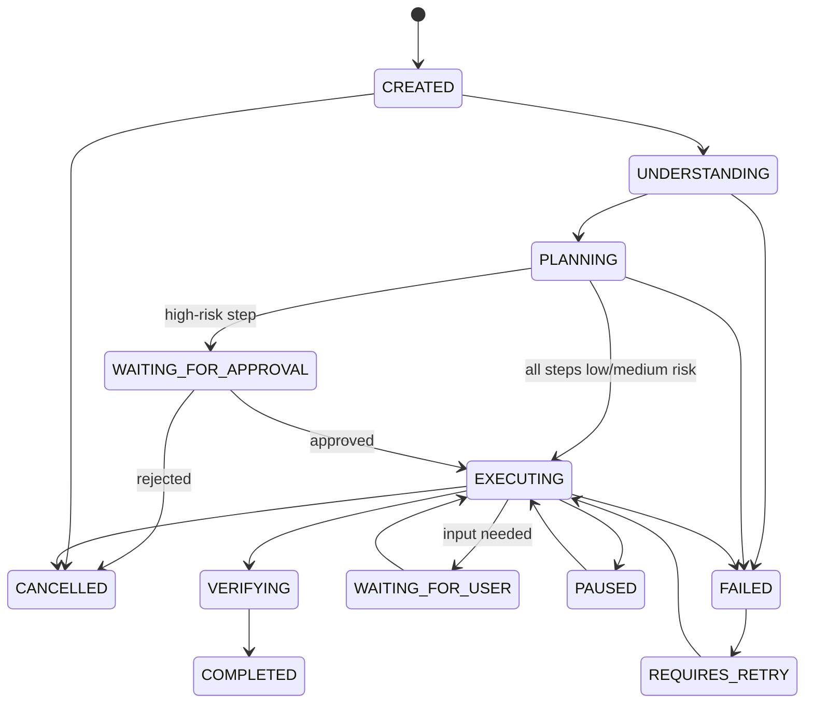
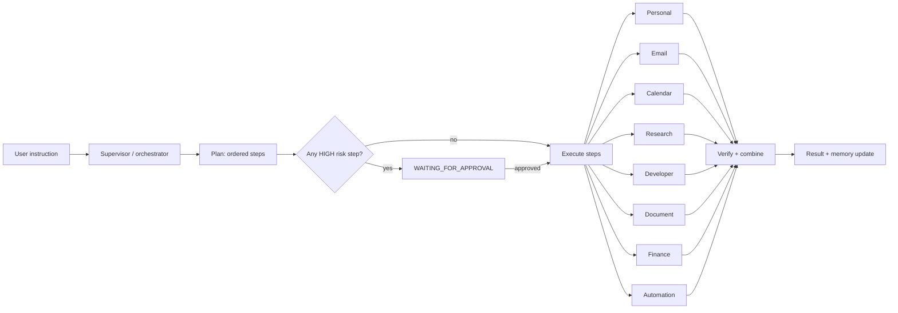
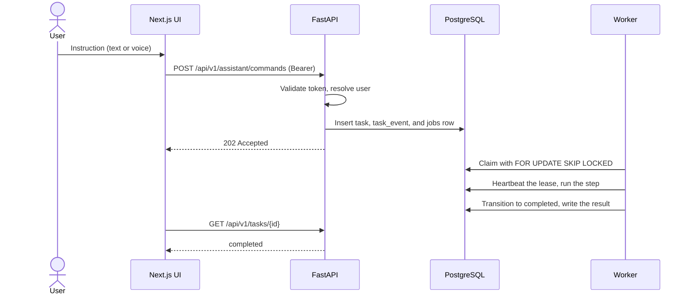
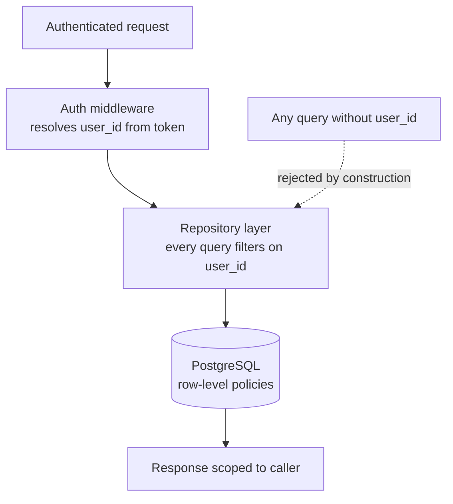

# JARVIS — System Architecture

**Author**: Abhishek Pandey
**Last Updated**: 2026-11-16

**Status:** Phase 1 (foundation). This document is the source of truth for
structure, boundaries, and constraints. It is updated at the end of every phase.

**Product principle:** One AI brain. One persistent memory. Multiple specialist
agents. One continuous task engine. Accessible everywhere through a browser.
Zero required device installations.

---

## 1. What JARVIS is — and is not

JARVIS is a cloud-hosted personal AI operating assistant. The browser is the
only user interface. All reasoning, memory, orchestration, and execution run on
infrastructure the user does not install.

JARVIS is **not**:

- A native macOS, iOS, or iPadOS application.
- A browser extension or local background agent.
- A system that controls the user's Mac, iPhone, or local filesystem.
- An always-on wake-word listener. Browsers cannot do this without an open tab
  and an explicit user gesture, and we do not pretend otherwise.

Anything JARVIS cannot actually do is surfaced in the UI as unavailable rather
than mocked. See §8.

---

## 2. System context



The web app never talks to a database, a model provider, or an integration
directly. Every privileged operation goes through the API, which enforces
authentication, per-user isolation, and permission checks.

---

## 3. Repository layout

```text
jarvis/
  apps/api/            FastAPI service (auth, conversations, memory, tasks)
  apps/worker/         Durable executor. Claims jobs from PostgreSQL.
  apps/web/            Next.js UI. Talks only to the API.
  packages/shared/     Types only. Agent contracts live in jarvis_shared.agents.
  database/migrations/ Alembic. The only way the schema changes.
  docs/                architecture, api, security
  tests/               Cross-service integration tests
  docker-compose.yml
  .env.example
```

`packages/shared` contains types only. It imports nothing from `apps/`, so the
API and worker cannot drift apart on the shape of a task, a memory, or an agent
result.

---

## 4. Backend

**FastAPI + Pydantic v2 + SQLAlchemy 2.0 (async) + Alembic.**

| Concern | Choice | Why |
|---|---|---|
| API | FastAPI | Async, typed, generates OpenAPI |
| Validation | Pydantic v2 | One schema language for API, DB, and agents |
| ORM | SQLAlchemy 2.0 async | Explicit SQL, asyncpg driver |
| Migrations | Alembic | Schema changes are reviewable and reversible |
| Auth | JWT access token + rotating refresh token | Short-lived credentials, revocable sessions |
| Streaming | Server-Sent Events | Works through proxies; no socket state to recover |
| Tasks | PostgreSQL durable queue (`FOR UPDATE SKIP LOCKED`) | Postgres is the source of truth; no separate queue to desync from it |
| Vectors | pgvector | One database, transactional with the memories it indexes |

### Provider interfaces

Model and speech providers sit behind interfaces in `apps/api/app/ai/`.
Business logic names a capability (`complete`, `transcribe`, `synthesize`),
never a vendor or a model. The concrete provider and model come from
configuration. A missing credential degrades to an explicit "not configured"
response — it never falls back to fabricated output.

```python
class LanguageModel(Protocol):
    name: str
    async def complete(self, messages: list[Message], **opts) -> Completion: ...
    def stream(self, messages: list[Message], **opts) -> AsyncIterator[str]: ...
```

---

## 5. The task engine

This is the part that makes JARVIS an operating assistant rather than a
chatbot. A task is a durable record, not an in-memory coroutine.

### State machine



Every transition is written to `task_events` in the same transaction as the
state change. There is no state change without a recorded event, and no event
without a state change.

### Durability rules

1. **PostgreSQL holds the truth.** Task state, step state, checkpoints, and
   the job queue itself live in Postgres. Workers claim jobs with
   `FOR UPDATE SKIP LOCKED`, using lease tokens, fencing, and heartbeats for
   recovery. There is no separate queue; Redis is not used for task dispatch.
2. **A worker crash loses nothing.** On startup a worker reclaims tasks stuck
   in `EXECUTING` past their heartbeat timeout and requeues them. Steps are
   idempotent, keyed by `(task_id, step_index, attempt)`.
3. **Closing the browser changes nothing.** The browser is a subscriber to task
   events, not a participant in execution.
4. **Restart survival is tested**, not assumed. The integration test kills the
   worker mid-task and asserts the task still completes.

### Approval gating

Each agent action carries a risk class (see
[security model](../security/SECURITY.md)). A plan containing any `HIGH` risk
step transitions to `WAITING_FOR_APPROVAL` and does not proceed until the user
approves that specific step. Approval is bound to the exact action payload, so
a step cannot be swapped after approval.

---

## 6. Agent architecture

A supervisor is the only component that plans. Specialist agents execute one
assigned step and return structured output. They cannot plan, delegate, or call
tools outside their declared permissions.



Every agent is a data record, not a class hierarchy: an ID, a description, a
capability list, a permission list, input/output schemas, a timeout, and a
retry policy. Adding an agent means adding a record and a handler, not editing
the orchestrator.

Phase 1 registers the eight agents and their contracts. It does not yet give
them real tools — an agent with no connected integration reports that fact
instead of inventing a result.

---

## 7. Memory

Ten categories: personal profile, communication preferences, professional
context, current projects, long-term goals, technical knowledge, decisions,
recurring tasks, conversation summaries, user-defined instructions.

Two retrieval paths, merged by a weighted score:

- **Keyword** — PostgreSQL full-text search (`tsvector`), exact and fast.
- **Semantic** — pgvector cosine distance over embeddings.

Ranking combines semantic similarity, keyword rank, recency decay, and an
explicit importance weight the user can set. Every memory stores its source
(which conversation, which message) and a privacy class. A memory tagged
`sensitive` is excluded from any agent whose permissions do not include it.

**Nothing becomes a memory automatically.** The orchestrator may *propose* a
memory; only the user, or an explicit user instruction to remember something,
commits it. Unverified inferences are never persisted as fact.

---

## 8. What zero-install makes impossible

These are constraints of the platform, not missing features. They are
documented here so they are never quietly "implemented" by faking them.

| Requested capability | Reality | What JARVIS does instead |
|---|---|---|
| Always-on wake word | A browser tab cannot listen permanently, and iOS suspends background tabs | Push-to-talk microphone button; optional Siri Shortcut that opens JARVIS with a prompt |
| Control of native Mac apps | No local process exists to drive them | Cloud browser automation and official APIs only |
| Local filesystem access | The browser sandbox forbids it | Cloud document storage and connected drives (Drive, OneDrive) |
| Background work on the device | Impossible without an install | All background work runs in the cloud worker |
| Reliable push on iOS Safari | Web Push on iOS requires the site to be added to the Home Screen, which is a user action we cannot require | In-app notifications always; web push where the browser grants it; email as the guaranteed channel |
| Unrestricted computer use | Would require a local agent | Isolated cloud browser with per-session limits, timeouts, and an audit log |

---

## 9. Cross-device continuity

All state that matters lives in PostgreSQL, keyed by `user_id`: conversations,
messages, memories, tasks, approvals, notifications, preferences. The browser
holds only the access token (in memory) and the refresh token (HttpOnly,
Secure, SameSite cookie).

Opening JARVIS on a second device is a login plus a fetch. There is no sync
protocol because there is no local replica.

---

## 10. Deployment

`docker-compose.yml` runs the full stack locally: Postgres, Redis, API, worker,
web, and Caddy. The same images deploy to a single host or a managed platform
without code changes; only environment variables differ.

Production expects managed PostgreSQL, managed Redis, and S3-compatible object
storage. Terraform under `infrastructure/terraform/` is intentionally empty in
Phase 1 — infrastructure is not provisioned until the application justifies it.

---

## 11. Phase status

| Phase | Scope | Status |
|---|---|---|
| 1 | Architecture, monorepo, database, auth, health, task state machine | **In progress** |
| 2 | User management, sessions, preferences | Not started |
| 3 | Conversations and model provider integration | Not started |
| 4 | Persistent memory and retrieval | Not started |
| 5 | Agent orchestration | Not started |
| 6 | Durable task execution and worker | Not started |
| 7 | Voice interface | Not started |
| 8 | External integrations | Not started |
| 9 | Notifications and automations | Not started |
| 10 | Security hardening | Not started |
| 11 | Observability | Not started |
| 12 | Production deployment | Not started |

---

## 12. Conversation Engine

### Flow

1. The user posts a message to `/api/v1/conversations/{id}/stream`.
2. The message is stored before any model call, so a provider failure never
   loses what the user typed.
3. `build_context` assembles the system prompt, preferences, up to ten active
   memories, the conversation summary, and recent messages, dropping the oldest
   until the result fits a 6,000-token budget.
4. The provider streams deltas. Each becomes an SSE `text.delta` event.
5. The completed text is stored as an assistant message. If the provider is
   not configured, the stored message says so and names the error code.

A non-streaming variant lives at `POST /conversations/{id}/messages`. It asks
the supervisor to plan first and, when the plan needs execution and no
approval, creates a task through the existing `Task` and `TaskStep` models.

### Provider

`app/ai/provider_factory.py` is the only place that decides which provider
runs. With no `OPENAI_API_KEY` it raises `NotConfigured`, and the API returns
503 `ai_not_configured`. Nothing substitutes a fake answer.

### Supervisor

`app/ai/supervisor.py` returns a `Plan`. Before anything acts on it,
`validate_plan` removes agents that are not in the registry and forces
`requires_approval` when an action contains send, delete, pay, purchase,
deploy, publish, or transfer. The model cannot add an agent or lower a risk.

### Limitations

- Execution is in-process. It does not survive an API restart.
- A streamed reply is stored after the final event. A client that disconnects
  before that point loses the reply. The user's message is already stored.
- Task creation commits separately from the reply. A crash between the two can
  leave a reply without its task.
- Context budgeting counts characters, not tokens. It is a ceiling, not an
  exact bill.
- Cost figures in `app/ai/usage.py` are estimates for two models and are
  labelled as such.

---

## 13. Voice

Phase 7. Capture and playback stay in the browser the user already has open.
Nothing is installed, and there is no wake word.

### What is implemented

The web client has a hold-to-talk control and an English/Hindi switch. Holding
the control starts the browser's speech recognition in the locale returned by
`GET /api/v1/voice/session`. Releasing it stops listening. A finished transcript
is submitted as a voice command to `POST /api/v1/assistant/commands` with
`source: web` and the open conversation id. That is the same planner and the
same queue as Siri and Google Assistant. Typed messages stay on the conversation
stream and are not spoken back. If the voice submit fails, the transcript is
put back in the message field so it can be sent as text.

`POST /api/v1/voice/speak` shortens a finished reply to the 240-character voice
limit and returns the text plus a BCP-47 language tag. The browser speaks that
text with its own speech synthesis. The response `audio` field is `null`: this
API does not generate audio.

When the browser has no speech recognition, the client tells the user to type.
That is the text fallback, and `text_fallback` is always true: typing remains
valid even if a server speech credential is added later. A missing credential is
reported separately. `stt_configured` and `tts_configured` are false on
`/api/v1/health`, and no transcript is invented. A voice command whose locale is
not English or Hindi is rejected with 422 before planning.

### What is not implemented

`STT_PROVIDER` and `TTS_PROVIDER` are accepted as configuration and reported in
health. No vendor implementation is wired, because no credential is configured
and none was invented. A future provider implements `transcribe` and
`synthesize` behind `app/ai/speech.py` and does not change the command gateway.

Wake-word activation is not possible under the zero-install constraint and is
not built. No microphone permission is requested until the user holds the
control.

---

## 14. Diagrams

Rendered versions of the diagrams in [this document](#2-system-context) and
[SECURITY.md](../security/SECURITY.md).

### Request lifecycle



Closing the browser drops the SSE connection only. The worker keeps running
because it never depended on the connection.

### Data isolation



Isolation is enforced twice: the repository layer requires a `user_id`
argument and will not construct a query without one, and PostgreSQL row-level
security rejects rows the session is not permitted to see. Either control
failing closed is sufficient; both are present so one regression is not enough
to leak data.
