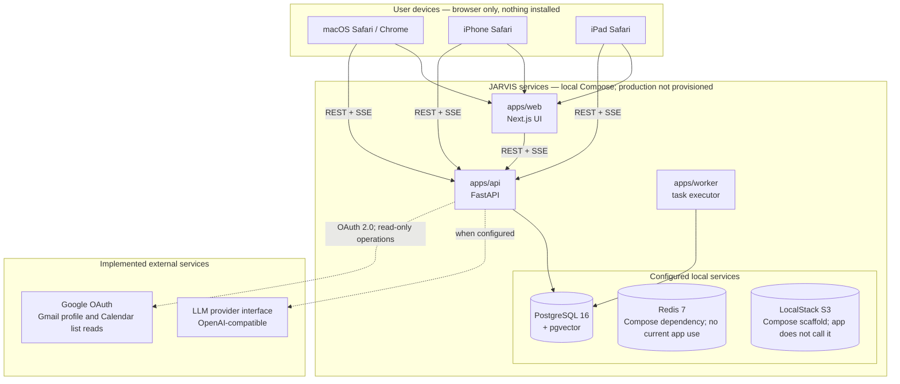
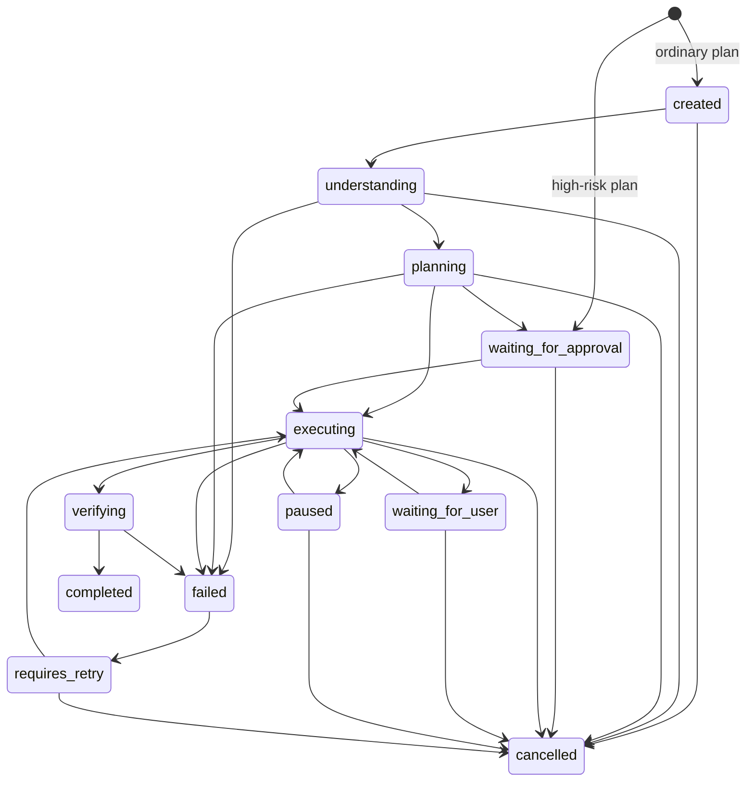
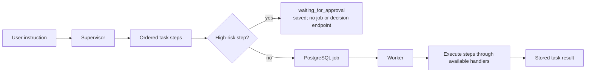
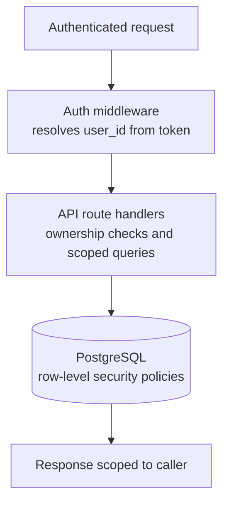

# JARVIS — System Architecture

**Author**: Abhishek Pandey
**Last Updated**: 2026-11-22

**Status:** Code exists for work across phases 1 through 11, but some phase
features remain incomplete and verification varies by feature. Phase 12
(production deployment) is not provisioned. Tests and code review recorded in
[roadmap.md](roadmap.md#current-implementation-status) do not imply a live
deployment. This document describes the implemented structure, boundaries,
and constraints.

**Product principle:** One AI brain. One persistent memory. Multiple specialist
agents. One continuous task engine. Browser-based access with no required device
installation.

---

## 1. What JARVIS is — and is not

JARVIS is a browser-based personal AI assistant. The web app calls a separate
API and worker; local development uses Compose. Production deployment has not
been provisioned. The browser is the user interface, and no device installation
is required.

JARVIS is **not**:

- A native macOS, iOS, or iPadOS application.
- A browser extension or local background agent.
- A system that controls the user's Mac, iPhone, or local filesystem.
- An always-on wake-word listener. Browsers cannot do this without an open tab
  and an explicit user gesture, and we do not pretend otherwise.

Anything JARVIS cannot actually do is surfaced in the UI as unavailable rather
than mocked. See §8.

---

## 2. System context



The web app never talks to a database, a model provider, or an integration
directly. Every privileged operation goes through the API, which enforces
authentication, per-user isolation, and permission checks.

---

## 3. Repository layout

```text
jarvis/
  apps/api/            FastAPI service (auth, conversations, memory, tasks)
  apps/worker/         Durable executor. Claims jobs from PostgreSQL.
  apps/web/            Next.js UI. Talks only to the API.
  packages/shared/     Shared contracts and pure helper modules.
  database/migrations/ Alembic. The only way the schema changes.
  docs/                architecture, api, security, apps
  tests/               Cross-service integration tests
  infra/compose/       docker-compose.yml
  infra/k8s/           Kubernetes manifests for local kind deployment
  config/env/          .env.example
```

`packages/shared` contains shared contracts and pure helpers, including the agent registry and task state machine. It imports nothing from `apps/`, keeping these shared definitions independent of API and worker implementation details.

No directory holds more than four files, excluding `.git`, `.venv`, `__pycache__`, and generated build output such as `*.egg-info/` and `.next/`. Modules that would have broken that cap are packages (`app.briefing`, `app.db`, `app.routers.auth`) so existing imports stay valid. Alembic keeps one history: `version_locations` lists `revisions_0001_0003`, `revisions_0004_0006`, and `revisions_0007_0009`.

---

## 4. Backend

**FastAPI + Pydantic v2 + SQLAlchemy 2.0 (async) + Alembic.**

| Concern | Choice | Why |
|---|---|---|
| API | FastAPI | Async, typed, generates OpenAPI |
| Validation | Pydantic v2 | One schema language for API, DB, and agents |
| ORM | SQLAlchemy 2.0 async | Explicit SQL, asyncpg driver |
| Migrations | Alembic | Schema changes are reviewable and reversible |
| Auth | JWT access token + rotating refresh token | Short-lived credentials, revocable sessions |
| Streaming | Server-Sent Events | Works through proxies; no socket state to recover |
| Tasks | PostgreSQL durable queue (`FOR UPDATE SKIP LOCKED`) | Postgres is the source of truth; no separate queue to desync from it |
| Vectors | pgvector extension | The memory embedding column exists but is not written or searched |

### Provider interfaces

Model providers sit behind an interface in `apps/api/app/ai/`; the concrete
provider and model come from configuration. Speech providers sit behind the
same kind of interface in `apps/api/app/ai/speech/`; `openai` is the only
implemented STT/TTS provider, used only if `STT_PROVIDER`/`TTS_PROVIDER` is set
to `openai` and an OpenAI credential is present. Browser Web Speech APIs remain
the default voice capture/playback path regardless of server configuration.
Missing model or speech credentials produce an explicit "not configured"
response rather than fabricated output.

```python
class LanguageModel(Protocol):
    name: str
    async def complete(self, messages: list[Message], **opts) -> Completion: ...
    def stream(self, messages: list[Message], **opts) -> AsyncIterator[str]: ...
```

---

## 5. The task engine

This is the part that makes JARVIS an operating assistant rather than a
chatbot. A task is a durable record, not an in-memory coroutine.

### State machine

The shared task helper defines the legal transitions below. Task creation stores
ordinary plans as `created` and high-risk plans as `waiting_for_approval`.



Application transition paths insert `task_events` in the same transaction as
the state change. Database permissions do not enforce `task_events` as
append-only.

A high-risk plan is saved with its steps but no job. There is no approve/reject
endpoint. The worker refuses `waiting_for_approval` tasks with
`approval_required`; the task cancel route returns HTTP 409 (`not_cancellable`,
"No active job to cancel") because no job exists. Although the shared helper
allows transitions from `waiting_for_approval` to `executing` or `cancelled`,
no user-facing approval or rejection flow invokes them. `waiting_for_approval`
has no `expires_at` and is not expired.

### Durability rules

1. **PostgreSQL holds the truth.** Task state, step state, and the job queue
   itself live in Postgres. Workers claim jobs with
   `FOR UPDATE SKIP LOCKED`, using lease tokens, fencing, and heartbeats for
   recovery. There is no separate queue; Redis is not used for task dispatch.
2. **Expired leases are recoverable.** The worker reaps expired jobs according
   to their attempt policy. Completed steps are skipped on resume; a running
   step may be retried, so execution does not guarantee exactly-once side effects.
3. **Closing the browser changes nothing.** The worker executes queued jobs
   independently of the browser. The API supports pull-based sync-event replay,
   but the current web client does not subscribe to task events or poll the sync
   endpoint automatically.
4. **Restart survival is tested**, not assumed. The integration test kills the
   worker mid-task and asserts the task still completes.

### Approval gating

The supervisor marks high-risk plans as requiring approval. The task service
persists these plans in `waiting_for_approval` without inserting a job. The
approval decision flow is not implemented: there is no approve/reject endpoint,
and the worker rejects `waiting_for_approval` with `approval_required`.
`waiting_for_approval` has no `expires_at` and is not expired. No
payload hash or exact-action approval binding is implemented. See the
[security model](../security/SECURITY.md) for the risk classification.

---

## 6. Agent architecture

The supervisor plans tasks into ordered steps. The worker checks permissions
and runs each step; step results are stored in the task result. Agent registry
entries describe capabilities but do not implement them or guarantee that a
handler exists. Currently, Google integration steps perform read-only Gmail
profile-total or Calendar-list requests. Other agent steps fail with
`agent_not_implemented`; they do not perform the advertised capability.



Every agent is a data record, not a class hierarchy: an ID, name, description,
capabilities, permissions, timeout, retry count, and risk ceiling. Adding a
registry entry does not implement a worker handler.

Migration `0001` seeds 18 agent contracts into `agents` and
`agent_capabilities` (the diagram shows eight registry entries). Registry
entries do not mean every declared capability is implemented. Current Google
integration steps read Gmail profile totals and the Calendar list only.

---

## 7. Memory

The memory API supports these categories: `profile`, `preferences`, `work`,
`projects`, `goals`, `knowledge`, `decisions`, `routines`, `summaries`, and
`instructions`. `GET /api/v1/memory` searches content with SQL `ILIKE` or matches
an exact category; it returns at most 100 non-deleted rows, ordered by
`updated_at` descending. There is no semantic retrieval or embedding search.

Conversation context includes up to 10 active, non-deleted memories, ordered by
`updated_at` descending. It does not filter on `privacy_class`, so memories
tagged `sensitive` can be sent to the model when they fall within that limit.
Memory CRUD requires a user action. `POST /api/v1/memory` inserts an active row. There is no proposal, confirm, or reject route.

---

## 8. What zero-install makes impossible

These are constraints of the platform, not missing features. They are
documented here so they are never quietly "implemented" by faking them.

| Requested capability | Reality | What JARVIS does instead |
|---|---|---|
| Always-on wake word | No wake-word listener is implemented; browser speech capture uses the open page | Browser push-to-talk requires an explicit user action |
| Control of native Mac apps | No local process or browser automation is implemented | No native app control is available |
| Local filesystem access | No local filesystem integration or connected-drive integration is implemented | No file access outside the app's current API capabilities |
| Background work on the device | No device installation or device-side worker exists | Queued tasks run in the separate worker process when the services are running |
| Push notifications and email | No Web Push, APNs/FCM, or email delivery is implemented | Notification records can be fetched in-app; browser notifications require permission and are not guaranteed |
| Unrestricted computer use | No local computer control or isolated cloud browser is implemented | Only implemented task handlers and integrations are available |

---

## 9. Cross-device continuity

Conversations, messages, memories, tasks, notifications, and preferences are
stored in PostgreSQL and scoped by user. Sync events support pull-based cursor
replay; there is no local replica.

The web app stores the access token in `sessionStorage` and sends it as a Bearer
token. The refresh token is an HttpOnly cookie. On a 401 the client calls the
refresh endpoint once, skips that call when the failing request is the refresh
path itself, and shares one in-flight refresh across concurrent 401s. A second
device still requires login.

---

## 10. Deployment

`infra/compose/docker-compose.yml` runs PostgreSQL, Redis, LocalStack, a
one-shot migration service, the API, the worker, and the web app. There is no
reverse proxy in Compose. The application uses PostgreSQL for task data and the
job queue. LocalStack is an S3 scaffold that the application does not call;
Redis is not currently used by the application; task/command write limits and
login throttling are in-process.

`infra/k8s/` is an alternative, local-only path: Kubernetes manifests for a
single-node `kind` cluster, mirroring the same services as Compose (namespace,
RBAC, Postgres/Redis/LocalStack, a migration Job, and Deployments for the API,
worker, and web app). `infra/k8s/secrets/` holds the Secret manifests `kubectl
apply` requires in place of `.env` (not read by `kubectl apply`). The `kind`
config maps NodePorts to host ports 8001 (API) and 3001 (web); see
[Installation](../developer/INSTALLATION.md#path-b--local-kubernetes-kind) for
the full apply order and the known API/web port mismatch in the checked-in web
image. Like Compose, this is a local development target, not production
infrastructure.
Production infrastructure is not provisioned.

---

## 11. Phase status

| Phase | Scope | Status |
| --- | --- | --- |
| 1 | Architecture, monorepo, database, auth, health, task state machine | Implemented |
| 2 | User management, sessions, preferences | Partial; authentication exists, but session management, preferences, and hard deletion remain incomplete |
| 3 | Conversations and model provider integration | Implemented |
| 4 | Memory CRUD and keyword search | Partial; no semantic retrieval or proposal-and-commit flow |
| 5 | Agent orchestration | Partial; planning and validation exist, but most agent execution handlers are placeholders |
| 6 | Durable task execution and worker | Implemented |
| 7 | Browser voice interface | Implemented. Batch server STT/TTS is wired into hold-to-talk. OpenAI Realtime WebRTC is a second mode. Gemini Live is not built. |
| 8 | Gmail and Google Calendar OAuth | Implemented for profile-total and calendar-list reads only |
| 9 | Notifications and automations | Implemented; in-app only |
| 10 | Security hardening | Partial; see documented coverage gaps in [SECURITY.md](../security/SECURITY.md) |
| 11 | Observability | Implemented |
| 12 | Production deployment | Not started |

---

## 12. Conversation Engine

### Flow

1. The user posts a message to `/api/v1/conversations/{id}/stream`.
2. The message is stored before any model call, so a provider failure never
   loses what the user typed.
3. `build_context` assembles the system prompt, preferences, up to ten active,
   non-deleted memories ordered by `updated_at`, the conversation summary, and
   recent messages. It does not filter memories by `privacy_class`; sensitive
   memories can therefore be included. Oldest history is dropped to fit the
   approximate 6,000-token budget.
4. The provider streams deltas. Each becomes an SSE `text.delta` event.
5. The completed text is stored as an assistant message. If the provider is
   not configured, the stored message says so and names the error code.

A non-streaming variant lives at `POST /conversations/{id}/messages`. It asks
the supervisor to plan first and creates a task when execution is required.
High-risk plans are persisted as `waiting_for_approval` with steps but no job;
there is no approval endpoint.

### Provider

`app.ai.provider_factory` is the only place that decides which provider
runs. With no `OPENAI_API_KEY` it raises `NotConfigured`. The non-streaming
message route returns HTTP 503 `ai_not_configured`; the streaming route has
already started HTTP 200 and emits an SSE `error` event with that code. Nothing
substitutes a fake answer.

### Supervisor

`app.ai.supervisor` returns a `Plan`. Before anything acts on it,
`validate_plan` removes agents that are not in the registry and forces
`requires_approval` when an action contains send, delete, pay, purchase,
deploy, publish, or transfer. The model cannot add an agent or lower a risk.

### Limitations

- A plan that needs execution is persisted as a task. Ordinary plans receive a
  `jobs` row, which the worker claims with `FOR UPDATE SKIP LOCKED`; high-risk
  plans remain `waiting_for_approval` without a job. An API restart does not
  lose queued work. A streamed reply that never becomes a task is still stored
  only after the final event.
- A client that disconnects before the final event loses the reply. The user's
  message is already stored.
- Task creation commits separately from the reply. A crash between the two can
  leave a reply without its task.
- Context budgeting counts characters, not tokens. It is a ceiling, not an
  exact bill.
- Cost figures in `app.ai.usage` are estimates for two models and are
  labelled as such.

---

## 13. Voice

Phase 7. Capture and playback stay in the browser the user already has open.
Nothing is installed, and there is no wake word.

### What is implemented

The web client has a hold-to-talk control and an English/Hindi switch. Holding
the control starts the browser's speech recognition in the locale returned by
`GET /api/v1/voice/session`. Releasing it stops listening. A finished transcript
is submitted as a voice command to `POST /api/v1/assistant/commands` with
`source: web` and the open conversation id. That is the same planner and task
queue used by the command gateway. The accepted `source: siri` and
`source: google_assistant` values are attribution labels, not native iOS or
Android invocations. Typed messages stay on the conversation stream and are not
spoken back. If the voice submit fails, the transcript is
put back in the message field so it can be sent as text.

`POST /api/v1/voice/speak` shortens a finished reply to the 240-character voice
limit and returns the text plus a BCP-47 language tag. If no TTS provider is
configured, `audio` is `null` and the web client falls back to the browser's
own speech synthesis, which is not an error. If `TTS_PROVIDER=openai` and an
OpenAI credential is set, `audio` is a base64-encoded MP3 clip
(`audio_format: "mp3"`) and the web client plays it via `playAudio()` in
`apps/web/lib/speech.ts` instead of browser TTS. The web client calls
`/speak` after every voice command reply (`submitVoice` in
`apps/web/app/page.tsx`) and falls back to browser speech synthesis if the
call fails or returns no audio.

`POST /api/v1/voice/transcribe` accepts a multipart audio upload
(`audio/webm`, `audio/wav`, `audio/mpeg`, `audio/mp4`, or `audio/ogg`, under
10MB) and a `locale` field, and returns the transcript. It requires a
configured STT provider and returns 503 `stt_not_configured` otherwise; the
browser's own Web Speech recognition does not call this endpoint and is
unaffected by whether it is configured. The web client's hold-to-talk control
(`holdToTalk`/`releaseTalk` in `apps/web/app/page.tsx`) calls `/transcribe`
when `stt_configured` (from `/api/v1/health`) is true and the browser
supports `MediaRecorder`/`getUserMedia` (`recordingAvailable()` in
`apps/web/lib/speech.ts`): holding the control starts a recording
(`startRecording()`), releasing it stops the recording, uploads the resulting
Blob via `api.transcribe()`, and submits the returned text as the voice
command. If recording cannot start (e.g. microphone permission denied), or
`stt_configured` is false, or `MediaRecorder`/`getUserMedia` is unsupported,
it falls back to the existing browser `SpeechRecognition` capture path. If
`/transcribe` itself fails after a recording completes, the client shows an
error and the user can retry or type instead — no transcript is invented and
no browser-recognition retry is attempted for that same hold (recording and
recognition are not run concurrently).

When the browser has no speech recognition, the client tells the user to type.
That is the text fallback, and `text_fallback` is always true: typing remains
valid regardless of server speech configuration. `stt_configured` and
`tts_configured` on `/api/v1/health` reflect whether `STT_PROVIDER`/
`TTS_PROVIDER` is set to an implemented provider (`openai`, today) and a
matching OpenAI credential is present; a provider name set to anything else is
reported as not configured rather than silently accepted. A vendor call that
fails after its retries returns 503 `provider_error`, matching the pattern used
by the model provider elsewhere in this API; no transcript or audio clip is
invented. A voice command whose locale is not English or Hindi is rejected with
422 before planning, and the same rule applies to `/transcribe` and `/speak`.

### Realtime session

`POST /api/v1/voice/realtime/session` is the second voice mode. It requires the
caller, checks that the caller owns `conversation_id`, and mints a short-lived
OpenAI Realtime client secret. The response sets `provider: openai` and
`transport: webrtc`. The long-lived provider key stays on the server.
Missing speech configuration returns 503 `speech_not_configured`. A provider
failure returns 503 `provider_error`.
The web client calls `openRealtimePeer` only when the mint response has
`transport: webrtc` and a `client_secret`. A 503 mint falls back to the batch
or browser path. Any other mint failure sets the error and does not start the
microphone. The peer opens the microphone only after that check, exchanges SDP
with `https://api.openai.com/v1/realtime/calls`, and plays remote audio on the
returned track.
A committed turn calls `POST /api/v1/voice/realtime/tool`. That route accepts
only `submit_command`, requires the same owned conversation, and submits the
command to the assistant command gateway with `source: web`,
`input_type: voice`, and the caller-supplied `Idempotency-Key`. It does not
create a task itself. A replay of the same key returns the stored command
result.
Gemini Live is not implemented. Semantic voice-activity detection is not
implemented. There is no wake word, and no microphone permission is requested
until the user holds the control.

---

## 14. Diagrams

Rendered versions of the diagrams in [this document](#2-system-context) and
[SECURITY.md](../security/SECURITY.md).

### Request lifecycle

```mermaid
sequenceDiagram
    actor User
    participant Web as Next.js UI
    participant API as FastAPI
    participant DB as PostgreSQL
    participant W as Worker

    User->>Web: Instruction (text or voice)
    Web->>API: POST /api/v1/assistant/commands (Bearer)
    API->>API: Validate token, resolve user
    API->>API: Plan command
    alt plan requires execution
        API->>DB: Insert task, steps, and task_event
        alt ordinary executable plan
            API->>DB: Insert jobs row
        else high-risk plan
            Note over API,DB: waiting_for_approval; no job is inserted
        end
    else no execution required
        Note over API,DB: No task or job is created
    end
    API-->>Web: Command acknowledgement (202)
    opt task exists
        Web->>API: GET /api/v1/tasks/{id}
        API-->>Web: Current task status
        opt queued job exists
            W->>DB: Claim with FOR UPDATE SKIP LOCKED
            W->>DB: Heartbeat the lease, run the step
            W->>DB: Persist task transition and result
        end
    end
```

Closing the browser drops the SSE connection only. A queued job is independent
of that connection; a `waiting_for_approval` task has no job to run.

### Data isolation



API handlers perform ownership checks and scope tenant queries. Migration
`0009` applies row-level security policies to tenant-owned tables while the
application connects as a non-owner role. The worker GUC is accepted only by
the designated worker-access policies. RLS controls row visibility; it does not
provide a repository layer or enforce append-only records.
