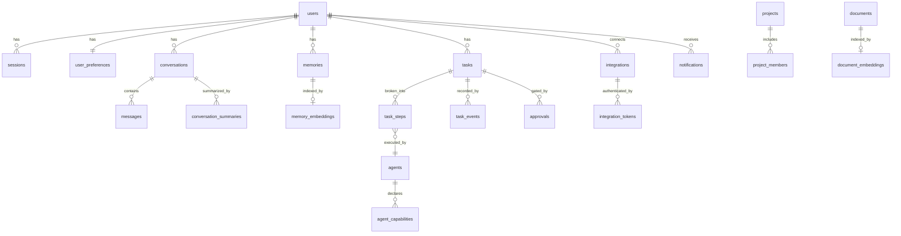

# JARVIS — Database Schema

PostgreSQL 16 with the `pgvector` and `pgcrypto` extensions. All schema changes
go through Alembic migrations in `database/migrations/`. Nothing creates or
alters tables at application startup.

## Conventions

- Primary keys are UUIDs, generated by the database (`gen_random_uuid()`).
- Every table has `created_at` and `updated_at` (`timestamptz`, UTC).
- Tables holding user data have `user_id` with a foreign key and an index, and
  row-level security enabled.
- Soft deletion uses `deleted_at`. Hard deletes are reserved for data the user
  explicitly asks to erase.
- Enum values are stored as text with a check constraint, not as native enum
  types, so adding a value is a migration rather than a lock.

## Entity relationships

## Tables

### Identity

**users** — `id`, `email` (unique, citext), `password_hash`, `display_name`,
`created_at`, `updated_at`, `deleted_at`.

**user_preferences** — `user_id` (pk, fk), `briefing_time`, `briefing_language`
(`en` or `hi`), `timezone`, `enabled_categories` (text array),
`notification_channels` (text array).

**sessions** — `id`, `user_id`, `refresh_token_hash`, `family_id`,
`replaced_by`, `user_agent`, `ip_address`, `expires_at`, `revoked_at`,
`created_at`. A reused rotated token revokes every session sharing its
`family_id`.

### Conversation

**conversations** — `id`, `user_id`, `title`, `created_at`, `updated_at`,
`deleted_at`.

**messages** — `id`, `conversation_id`, `user_id`, `role`
(`user`, `assistant`, `system`, `tool`), `content`, `token_count`,
`created_at`. Indexed on `(conversation_id, created_at)`.

**conversation_summaries** — `id`, `conversation_id`, `user_id`, `summary`,
`covers_until_message_id`, `created_at`.

### Memory

**memories** — `id`, `user_id`, `category` (one of the ten categories),
`content`, `privacy_class` (`normal`, `sensitive`), `importance` (0–1),
`source_conversation_id`, `source_message_id`, `expires_at`, `created_at`,
`updated_at`, `deleted_at`. Full-text index on `content`.

**memory_embeddings** — `memory_id` (pk, fk), `embedding` (vector(1536)),
`model`. HNSW index on `embedding` using cosine distance.

### Work

**projects** — `id`, `user_id`, `name`, `description`, `created_at`,
`updated_at`, `deleted_at`.

**project_members** — `project_id`, `user_id`, `role`, composite primary key.
Present for forward compatibility; Phase 1 has exactly one member, the owner.

**agents** — `id` (text slug, pk), `name`, `description`, `timeout_seconds`,
`max_retries`, `risk_ceiling`. Seeded by migration, not user-created.

**agent_capabilities** — `agent_id`, `capability`, composite primary key.

**agent_executions** — `id`, `agent_id`, `task_step_id`, `user_id`, `status`,
`input`, `output`, `error`, `started_at`, `finished_at`, `token_usage`.

**tasks** — `id`, `user_id`, `conversation_id`, `title`, `instruction`,
`status` (state machine values), `result`, `error`, `heartbeat_at`,
`created_at`, `updated_at`.

**task_steps** — `id`, `task_id`, `position`, `agent_id`, `action`,
`action_hash`, `risk`, `status`, `attempt`, `checkpoint`, `created_at`,
`updated_at`. Unique on `(task_id, position)`.

**task_events** — `id`, `task_id`, `from_status`, `to_status`, `reason`,
`actor`, `created_at`. Append-only.

**approvals** — `id`, `task_step_id`, `user_id`, `action_hash`, `status`
(`pending`, `approved`, `rejected`), `decided_at`, `created_at`.

### Integrations and documents

**integrations** — `id`, `user_id`, `provider`, `status`, `scopes` (text array),
`connected_at`, `disconnected_at`. Unique on `(user_id, provider)`.

**integration_tokens** — `integration_id` (pk, fk), `access_token_encrypted`,
`refresh_token_encrypted`, `expires_at`. Ciphertext only; the key is not in
the database.

**documents** — `id`, `user_id`, `project_id`, `name`, `media_type`,
`storage_key`, `byte_size`, `created_at`, `deleted_at`.

**document_embeddings** — `id`, `document_id`, `chunk_index`, `content`,
`embedding` (vector(1536)).

### Operations

**notifications** — `id`, `user_id`, `kind`, `title`, `body`, `read_at`,
`created_at`.

**automations** — `id`, `user_id`, `name`, `schedule` (cron), `action`,
`enabled`, `last_run_at`, `created_at`, `updated_at`.

**audit_logs** — `id`, `user_id`, `actor`, `action`, `target_type`,
`target_id`, `metadata` (jsonb), `created_at`. Append-only. No update or delete
grant for the application role.

## Indexing

- `messages (conversation_id, created_at)` — conversation replay.
- `tasks (user_id, status)` — dashboard and worker recovery query.
- `task_events (task_id, created_at)` — execution history.
- `memories` GIN index on `to_tsvector('english', content)` — keyword retrieval.
- `memory_embeddings` HNSW index — semantic retrieval.
- `notifications (user_id, read_at)` — unread counts.

## Phase 1 scope

Phase 1 creates `users`, `sessions`, `user_preferences`, `agents`,
`agent_capabilities`, `tasks`, `task_steps`, `task_events`, and `audit_logs`.
The remaining tables arrive with the phase that first writes to them, so the
schema never describes behaviour that does not exist yet.
