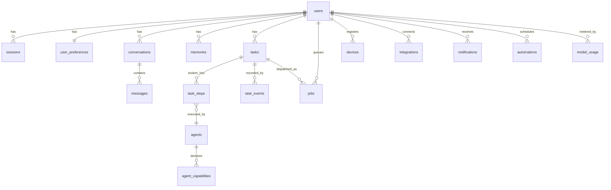

# JARVIS — Database Schema

**Author**: Abhishek Pandey
**Last Updated**: 2026-11-16

PostgreSQL 16 with the `pgvector` and `pgcrypto` extensions. All schema changes
go through Alembic migrations in `database/migrations/`. Nothing creates or
alters tables at application startup.

## Conventions

- Most primary keys are UUIDs. Migrations `0001` and `0002` default them with
  `gen_random_uuid()`. Later tables omit that default, so the application
  supplies the id. `sync_events.id` is a `bigint` identity. `agents.id` and
  `oauth_states.state` are text.
- Timestamps are `timestamptz` in UTC. Not every table has `updated_at`.
- Tenant tables have `user_id` with a foreign key and an index, except
  `task_steps` and `task_events`, which join to `tasks`.
- Soft deletion uses `deleted_at` on `users`, `conversations`, and `memories`.
  Other tables are hard-deleted or revoked. Account erasure of remaining rows
  is outstanding.
- Enum values are stored as text with a check constraint, not as native enum
  types, so adding a value is a migration rather than a lock.

## Entity relationships

## Tables

Migrations `0001` through `0009` create these tables and no others.

### Identity

**users** — `id`, `email` (unique text, not citext), `password_hash`,
`display_name`, `created_at`, `updated_at`, `deleted_at`.

**user_preferences** — `user_id` (pk, fk), `timezone`, `briefing_language`
(`en` or `hi`), `created_at`.

**sessions** — `id`, `user_id`, `refresh_token_hash`, `family_id`,
`replaced_by`, `user_agent`, `expires_at`, `revoked_at`, `created_at`. No
`ip_address`. A reused rotated token revokes every session sharing its
`family_id`.

### Conversation and memory

**conversations** — `id`, `user_id`, `title`, `status`, `summary`, `created_at`,
`updated_at`, `deleted_at`.

**messages** — `id`, `conversation_id`, `user_id`, `role`, `content`,
`content_type`, `token_usage` (jsonb), `provider`, `model`, `created_at`.
Indexed on `(conversation_id, created_at)`.

**memories** — `id`, `user_id`, `category`, `content`, `privacy_class`
(`normal`, `sensitive`), `active`, `source_conversation_id`,
`source_message_id`, `embedding vector(1536)`, `created_at`, `updated_at`,
`deleted_at`. The embedding column is unused. Keyword search is SQL `ILIKE`,
not a full-text index.

### Work

**agents** — `id` (text slug, pk), `name`, `description`, `timeout_seconds`,
`max_retries`, `risk_ceiling`. Seeded by migration, not user-created.

**agent_capabilities** — `agent_id`, `capability`, composite primary key.

**tasks** — `id`, `user_id`, `conversation_id` (nullable, `ON DELETE SET NULL`,
added in `0003`), `title`, `instruction`, `status`, `result`, `error`,
`heartbeat_at`, `created_at`, `updated_at`. No `risk` column; risk lives on
`task_steps`.

**task_steps** — `id`, `task_id`, `position`, `agent_id`, `action`, `risk`,
`status`, `attempt`, `created_at`, `updated_at`. Unique on
`(task_id, position)`. No `user_id`; tenancy is the parent task.

**task_events** — `id`, `task_id`, `from_status`, `to_status`, `reason`,
`actor`, `created_at`. Application transition paths insert events, but
append-only behavior is not database-enforced: migration `0009` grants the
runtime role `UPDATE` and `DELETE`. No `user_id`.

**jobs** — the durable queue. `id`, `user_id`, `task_id`, `job_type`
(`task_execution` only), `payload`, `status`, `priority`, `attempt_count`,
`max_attempts`, `available_at`, `locked_at`, `lease_expires_at`, `worker_id`,
`lease_token`, `heartbeat_at`, `last_error`, `cancel_requested`, `created_at`,
`started_at`, `completed_at`. Workers claim with `FOR UPDATE SKIP LOCKED`.
One active job per task.

**idempotency_keys** — `(user_id, key)` primary key, `request_hash`, `task_id`,
`created_at`. A repeated command returns the existing task.

### Devices, integrations, operations

**devices** — `id`, `user_id`, `platform`, `label`, `created_at`,
`last_seen_at`, `revoked_at`. Attribution only. The token authenticates.

**sync_events** — `id` (bigint identity), `user_id`, `device_id`, `kind`,
`payload`, `created_at`. Clients replay with a cursor.

**integrations** — `id`, `user_id`, `provider` (`gmail`, `google_calendar`),
`status`, `scopes`, `account_label`, `token_ciphertext`, `created_at`,
`updated_at`, `connected_at`, `revoked_at`. Unique on `(user_id, provider)`.
Ciphertext only; the key is not in the database.

**oauth_states** — `state` (pk), `user_id`, `provider`, `code_verifier`,
`created_at`, `expires_at`, `consumed_at`.

**notifications** — `id`, `user_id`, `kind`, `title`, `body`, `channel`
(`in_app` only), `dedupe_key`, `read_at`, `created_at`.

**automations** — `id`, `user_id`, `name`, `body` (added in `0007`), `hour`,
`minute`, `timezone`, `enabled`, `last_slot`, `created_at`, `updated_at`. Not a
cron expression.

**audit_logs** — `id`, `user_id`, `actor`, `action`, `target_type`,
`target_id`, `metadata` (jsonb), `created_at`. No `ip_address`. No RLS.
Migration `0009` grants the runtime role `UPDATE` and `DELETE`, so append-only
behavior is not enforced by database permissions.

**model_usage** — `id`, `user_id`, `task_id`, `provider`, `model`,
`input_tokens`, `output_tokens`, `estimated_cost_usd`, `created_at`. No prompt
and no reply. No RLS.

## Indexing

- `messages (conversation_id, created_at)` — conversation replay.
- `tasks (user_id, status)` — dashboard query.
- `task_events (task_id, created_at)` — execution history.
- `jobs` partial indexes on queued claim order and running lease expiry.
- `notifications (user_id, read_at)` — unread counts.
- `sync_events (user_id, id)` — cursor replay.

There is no HNSW index. `memories.embedding` is not written.

## Row-level security

Migration `0009` creates the non-owner role `jarvis_app` and grants it
`SELECT`, `INSERT`, `UPDATE`, and `DELETE` on existing tables. It does not
transfer ownership. The owner remains `jarvis`. `FORCE ROW LEVEL SECURITY` is
applied only to the tenant tables: `tasks`, `conversations`, `messages`,
`memories`, `jobs`, `idempotency_keys`, `devices`, `sync_events`,
`integrations`, `oauth_states`, `notifications`, `automations`, `task_steps`,
and `task_events`. `jarvis_app` cannot bypass those policies.

The API sets `app.user_id` for the request. Policies compare
`NULLIF(current_setting('app.user_id', true), '')::uuid`, so an unset or empty
GUC matches no row. The worker sets `app.worker` to `true` (not `on`) with
`set_config(..., true)`, then sets `app.user_id` to the claimed job's owner
when that owner can be read. The worker predicate applies only to `jobs`,
`idempotency_keys`, `task_steps`, `task_events`, `automations`, and
`notifications`.

`users`, `sessions`, `user_preferences`, `agents`, `agent_capabilities`,
`audit_logs`, and `model_usage` have no RLS. `task_steps` and `task_events`
are visible only when the parent task belongs to `app.user_id`, or when
`app.worker` is `true`. RLS controls row visibility, not whether permitted
rows can be updated or deleted.

Tables that do not exist: `conversation_summaries`, `memory_embeddings`,
`projects`, `project_members`, `agent_executions`, `approvals`,
`integration_tokens`, `documents`, `document_embeddings`. Do not document them
until a migration creates them.
