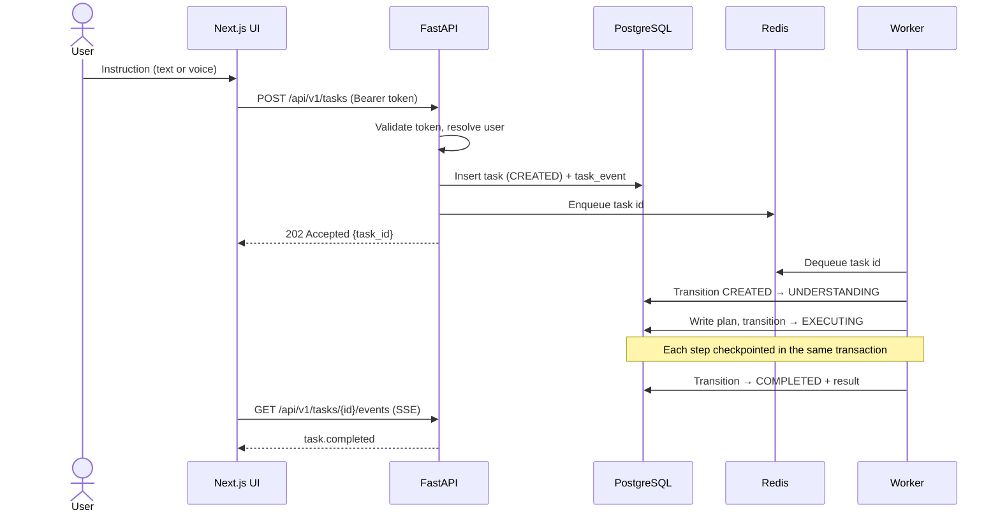
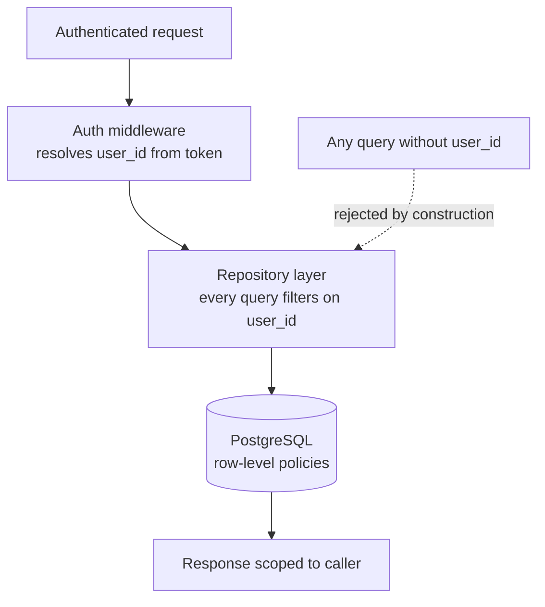

# JARVIS — Diagrams

Rendered versions of the diagrams in
[ARCHITECTURE.md](ARCHITECTURE.md) and [SECURITY.md](../security/SECURITY.md).
Kept separate so the architecture document stays readable.

## Request lifecycle

Closing the browser drops the SSE connection only. The worker keeps running
because it never depended on the connection.

## Data isolation

Isolation is enforced twice: the repository layer requires a `user_id`
argument and will not construct a query without one, and PostgreSQL row-level
security rejects rows the session is not permitted to see. Either control
failing closed is sufficient; both are present so one regression is not enough
to leak data.
