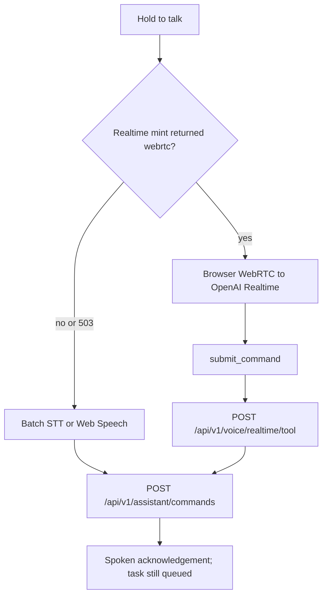

# JARVIS — Implementation Roadmap

**Author**: Abhishek Pandey
**Last Updated**: 2026-11-21

Each phase ends with working, tested software and updated documentation. A
phase is not done because code was written; it is done because its tests pass.
The verification column records checks against this checkout; passing tests or
code review do not establish that a feature is available in a live deployment.

## Current implementation status

Audited 2026-11-15 against the working tree, not against earlier notes. A row
is verified only when a command was run and its output observed. Verification
is evidence about this checkout and the stated test environment, not proof of a
live or production deployment.

| Feature         | Existing implementation                                                                                                                                                                                                                                                        | Verified                                                                                                                | Remaining work                                                                                                |
| --------------- | ------------------------------------------------------------------------------------------------------------------------------------------------------------------------------------------------------------------------------------------------------------------------------ | ----------------------------------------------------------------------------------------------------------------------- | ------------------------------------------------------------------------------------------------------------- |
| Authentication  | Register, login, logout, API refresh with rotation and family revocation, session lookup, password change, soft account deletion. Argon2id, HttpOnly refresh cookie, in-process login throttle. Password change and deletion revoke every session for the account. The web client refreshes once on a 401, skips the refresh path, and shares one in-flight refresh. | Yes. `tests/security/test_auth.py` and `tests/security/test_review_regressions.py`, against PostgreSQL. Client refresh helpers are in `apps/web/lib/api.ts`. | Redis-backed rate limiting. Hard deletion of user data. |
| Database        | PostgreSQL 16 with pgvector; migrations `0001` through `0009` are checked in. `0009` creates the non-owner `jarvis_app` runtime role, forces RLS on tenant-owned tables, and adds `WITH CHECK` policies.                                                                 | `tests/security/test_security.py` defines coverage for fail-closed RLS, cross-tenant reads of memories/devices, worker-GUC SELECT visibility of a foreign job, and rejection of a cross-tenant task insert. This review did not verify the live DB version; the prior row recorded `0005`. | Verify deployment DBs applied `0009`; expand coverage for joined-table and non-queue worker-GUC boundaries. |
| Agents          | 18 agents in `jarvis_shared.agents` and seeded by migration `0001`.                                                                                                                                                                                                            | Yes. `select count(*) from agents` returns 18. Registry import returns 18.                                              | No idempotent re-seed command. The migration inserts once; a second run is a no-op because Alembic tracks it. |
| Task execution  | Durable PostgreSQL queue. The task helper defines legal transitions; the worker claims queued jobs with leases and fencing. High-risk tasks are saved as `waiting_for_approval` without a job. No approve/reject endpoint exists; the worker rejects that status, and cancellation returns 409 when no active job exists. Google integration steps perform limited read-only requests; other agent steps currently fail with `agent_not_implemented` rather than performing their advertised capability. | Yes. `tests/jobs/test_durable_jobs.py` and `tests/jobs/test_worker_recovery.py`. CI runs `alembic upgrade head` and `python -m pytest` against a Postgres 16 service on pull requests and pushes to `main`. | Implement approval decisions and a supported cancellation path for waiting tasks (the current route returns 409). |
| Frontend        | Next.js app in `apps/web`: sign in, register, conversation list, streaming chat, stop control, hold-to-talk, English/Hindi switch.                                                                                                                                             | Partially. `tsc` not re-run this phase. No browser test was run.                                                        | Rename and delete exist in the API client but not in the UI. Microphone use is untested on a device.          |
| AI integration  | Provider interface, OpenAI implementation, factory that reports unconfigured instead of inventing a reply.                                                                                                                                                                     | Partially. Missing-key path verified: health reports `configured: false` and messaging returns 503 `ai_not_configured`. | No live call was made. No `OPENAI_API_KEY` is set.                                                            |
| Voice           | Browser Web Speech APIs provide push-to-talk, English and Hindi, and text fallback. A transcript is submitted to `POST /api/v1/assistant/commands` (`source: web`, `input_type: voice`). Unsupported voice locales are rejected. Typed chat is not spoken. No wake word. `POST /api/v1/voice/transcribe` and audio on `POST /api/v1/voice/speak` provide batch server-side STT/TTS when `STT_PROVIDER`/`TTS_PROVIDER=openai` and a credential is set. The web client calls `/speak` and plays returned audio, falling back to browser synthesis when none is returned. When `stt_configured` is true and recording is available, hold-to-talk records and calls `/transcribe`; it falls back to browser recognition if recording cannot start. A realtime session is a second mode: `POST /api/v1/voice/realtime/session` mints a short-lived OpenAI Realtime client secret after the caller owns the conversation. The browser opens WebRTC only when that response has `transport: webrtc` and a `client_secret`. A 503 mint falls back to the batch path. Any other mint failure surfaces the error and does not start the microphone. Committed turns call `POST /api/v1/voice/realtime/tool`, which submits `submit_command` through the command gateway with the caller-supplied idempotency key. | Yes. `tests/integrations/test_voice.py` covers transcribe, speak, realtime session, and realtime tool, including owner isolation and stubbed-provider failures. Browser capture, the client wiring, and a live OpenAI call were not exercised by an automated web test. | Browser reliability measurement (Phase 7a). Gemini Live, semantic VAD, and native speech-to-speech are not built (Phases 7c–7d). |
| Supervisor      | Plans a request, validates agents against the registry, forces approval on high-risk actions. One planner serves every source.                                                                                                                                                | Yes. `tests/assistant/test_supervisor.py`, 4 tests.                                                                               | Routing uses the model only when one is configured. Without a key it falls back to keyword matching.          |
| Command gateway | `POST /api/v1/assistant/commands` accepts a source-tagged contract (`siri`, `google_assistant`, `web`, `desktop`, `api`), normalizes it, and routes it through the shared planner. A device id is attribution, never authentication.                                           | Yes. `tests/assistant/test_assistant.py`, 4 tests, against PostgreSQL.                                                            | Not exercised from a physical Siri or Google Assistant device.                                                |
| Devices         | `devices` table with registration, per-device revocation, and last-seen tracking. Revoking a device blocks further commands attributed to it.                                                                                                                                  | Yes. `tests/assistant/test_assistant.py`.                                                                                         | No push transport (APNs/FCM). A client can poll `/api/v1/sync`; the current web UI does not.                                                    |
| Sync            | Durable `sync_events` log with cursor replay at `GET /api/v1/sync`. Scoped per user; idempotency rows are excluded from the feed.                                                                                                                                              | Yes. `tests/assistant/test_assistant.py` covers replay and cross-account isolation.                                               | No live SSE push. Replay is pull-based.                                                                       |
| Memory          | Table, CRUD API, keyword search, privacy class, active flag. Updates re-validate the privacy class.                                                                                                                                                                            | No. Endpoints exist; no test covers them.                                                                               | No embeddings are generated. The `embedding` column is empty.                                                 |
| Streaming       | SSE endpoint emitting `response.started`, `text.delta`, `response.completed`, `error`.                                                                                                                                                                                         | No. Code reviewed, not exercised against a provider.                                                                    | Needs a configured provider to verify end to end.                                                             |
| Integrations    | Gmail and Google Calendar OAuth connection flow with PKCE, single-use state, and Fernet ciphertext. Gmail reads the profile message total; Calendar reads the calendar list. No mail content, mail sending, or calendar writes are implemented. | Yes. `tests/integrations/test_integrations.py` and the email-step case in `tests/jobs/test_worker_recovery.py`. No live Google call was made.  | Configure a Google client to test live reads. No `GOOGLE_CLIENT_ID` is set.          |

### What is explicitly not done

- Semantic memory retrieval. `memories.embedding` is a `vector(1536)` column. `POST /api/v1/memory` writes category, content, privacy class, and active state. It does not write the embedding. Retrieval is `ILIKE` or an exact category match, capped at 100 rows.
- High-risk task approval decisions. Such tasks are stored without jobs; no approve/reject endpoint exists, and the worker refuses to run them. `waiting_for_approval` is not expired.
- Wake word and local device control. Impossible under the zero-install constraint.
- Gemini Live, semantic voice-activity detection, and native speech-to-speech. The OpenAI Realtime WebRTC path above is the only realtime mode.
- Server-side STT and TTS for any provider other than OpenAI. `get_transcriber()` and `get_synthesizer()` raise `NotConfigured` unless the matching provider is `openai` and a credential is set.
- Native Siri and Google Assistant invocation. Both require a native app to
  register intents; none is installed. See `docs/architecture/ASSISTANTS.md`.
- Push delivery to devices. Sync is pull-based replay, not APNs or FCM.
- Live LLM responses. No credential is configured, and none was invented.
- A live Google connection. No client id or secret is configured, so no mailbox
  or calendar was read.

## Phase 1 — Foundation (complete)

Monorepo, configuration, structured logging, PostgreSQL with migrations, the
identity tables, authentication (register, login, refresh, logout), the task
state machine with recorded transitions, agent registry, health endpoints, and
the API skeleton the UI talks to.

**Done when:** a user can register and log in; the shared task-state helper
accepts legal transitions and rejects illegal ones; application state changes
record `task_events`; and one user cannot read another's data. The API does not
expose arbitrary state transitions, and high-risk approval decisions are not
implemented.

## Phase 2 — User management

Preferences, session listing and revocation, account deletion that actually
deletes, password change.

## Phase 3 — Conversation and model integration

Conversations and messages persisted per user, the language-model provider
interface, streaming responses over SSE, a working chat view. Requires an
OpenAI-compatible credential; without one the UI shows "not configured" rather
than a canned reply.

## Phase 4 — Persistent memory

Memory CRUD, keyword and semantic retrieval, the proposal-then-commit rule so
nothing is remembered without confirmation, privacy classes, export and delete.

## Phase 5 — Agent orchestration

The supervisor plans a task into steps, routes each step to an agent, checks
permissions, and combines results. First real agent behaviours: research
(web) and personal assistant (briefing from data JARVIS actually has).

## Phase 6 — Durable execution (done)

The worker process claims from a PostgreSQL job table with `FOR UPDATE SKIP
LOCKED`, holds a lease it heartbeats, and reaps expired leases according to the
attempt policy. Cancellation and idempotency keys are in place. Covered by
`tests/jobs/test_durable_jobs.py` and `tests/jobs/test_worker_recovery.py`. The queue is
PostgreSQL, not Redis; Redis remains available for a future rate limiter.

## Phase 7 — Voice

**Goal:** improve the existing browser voice experience first, then pilot a
more responsive streaming interaction without removing typed chat or the
shared command path. The planned work below is not implemented unless the
status table or a phase explicitly says it is done.

### Phase 7 (done) — Current browser path

The web client uses browser Web Speech APIs for push-to-talk in English and
Hindi. A completed utterance is sent as text to
`POST /api/v1/assistant/commands`; the browser speaks a short reply. Typed chat
remains available but is not spoken automatically. The app does not currently
stream microphone audio to its backend. The voice tests cover API contracts,
not browser capture or playback. See section 13 of
`docs/architecture/ARCHITECTURE.md` and `tests/integrations/test_voice.py`.
There is no `docs/architecture/VOICE.md`.

### Phase 7 addendum (done) — Server-side batch STT/TTS

`POST /api/v1/voice/transcribe` (multipart upload) and audio output on
`POST /api/v1/voice/speak` (base64 MP3) are implemented against OpenAI, behind
`get_transcriber()`/`get_synthesizer()` in `apps/api/app/ai/speech/__init__.py`,
active only when `STT_PROVIDER`/`TTS_PROVIDER=openai` and a credential is set.
This is batch request/response, not streaming. The web client now calls
`/speak` and plays returned audio when present (`playAudio()` in
`apps/web/lib/speech.ts`, wired into `submitVoice` in
`apps/web/app/page.tsx`), falling back to browser `speechSynthesis` if no
audio is returned or the call fails. The web client's hold-to-talk control
also calls `/transcribe` (`api.transcribe()` in `apps/web/lib/api.ts`, used
from `startRecording()`/`recordingAvailable()` in `apps/web/lib/speech.ts`
and wired into `holdToTalk`/`releaseTalk` in `apps/web/app/page.tsx`) when
`stt_configured` is true and `MediaRecorder`/`getUserMedia` are available;
otherwise, or if starting a recording fails, it falls back to the existing
Web Speech `SpeechRecognition` capture path.

The batch path stays. It is the fallback when the browser cannot open a
realtime session, and it is also a standalone upload route. It does not
replace the realtime path below.

**Done when (met):** `POST /api/v1/voice/transcribe` returns a transcript for
a configured provider and 503 `stt_not_configured`/`provider_error` otherwise;
`POST /api/v1/voice/speak` returns `audio`/`audio_format` when TTS is
configured and `audio: null` otherwise; both covered by
`tests/integrations/test_voice.py` with a stubbed provider and a simulated
provider failure; the web client calls `/speak` and plays returned audio with
a browser-speech fallback, and calls `/transcribe` from hold-to-talk when STT
is configured and `MediaRecorder` is available, falling back to browser
speech recognition otherwise. Not done: an automated web test for either
client-side wiring path (no web test suite exists in this repo), and a live
call against OpenAI (no credential is configured in this checkout).

Browser recognition and synthesis support and quality vary by browser, device,
and environment. The app's backend receives the transcript rather than the
microphone audio, but the browser's speech service may process audio outside
this app; do not describe the current path as necessarily on-device or
private-by-default. No wake word is implemented.

### Realtime session (built for OpenAI WebRTC)

Speech stays an interaction surface. Tasks, approvals, and tenant isolation
stay on the command gateway. The batch and browser paths above remain the
fallback. A realtime session is a second mode. OpenAI Realtime over WebRTC is
implemented. Gemini Live is not.

**Browser-direct audio.** `POST /api/v1/voice/realtime/session` requires the
caller and checks that the caller owns the conversation, then mints a
short-lived OpenAI Realtime client secret. The browser opens WebRTC only when
the response has `transport: webrtc` and a `client_secret`. Microphone audio
for that session does not transit FastAPI. The long-lived provider key stays
on the server. The secret expires in minutes. A 503 mint falls back to the
batch path. Any other mint failure is shown and does not start the microphone.
Gemini Live is not implemented.

**One tool, the existing gateway.** The minted session exposes
`submit_command`. A committed turn calls `POST /api/v1/voice/realtime/tool`,
which submits that command to `POST /api/v1/assistant/commands` with
`source: web`, `input_type: voice`, the open conversation id, and the
caller-supplied `Idempotency-Key`. The tool route does not create a task
itself. `require_user` and the conversation ownership check stay on the mint
and on the tool route. A turn that needs execution still returns 202. The
worker does not stream audio. High-risk plans stay `waiting_for_approval`
with no job. This path does not add an approve/reject endpoint.

**Turn-taking and barge-in.** Semantic end-of-turn detection is the candidate
policy, because acoustic server VAD cuts on silence and false-triggers on a
thinking pause. Push-to-talk stays the default until Phase 7c measures a
change. On `speech_started` or `interrupted: true`, the client cancels
`speechSynthesis` and drops queued PCM before the next frame. Today
`stopSpeaking()` runs only when the user holds the control again, so the
assistant can talk over them. An interrupted turn truncates unplayed audio
(`conversation.item.truncate` with `audio_end_ms`, or an immediate discard of
the client buffer) so the next turn is not conditioned on words the user never
heard. Interim text may update a pending bubble; only a committed turn is
stored as a `Message`.

**What stays put.**

- No wake word. No microphone permission until the user starts a session.
- Locale stays `en` / `hi` via `normalize_locale`. Another locale still 422s.
- `text_fallback` stays true. Typed chat is not removed and is not spoken.
- The 240-character `voice_response` cut stays for the Web Speech fallback.
  Live audio may speak a longer reply. Stored `response_text` stays complete,
  and an unplayed tail is not stored as if the user heard it.
- `get_transcriber()` and `get_synthesizer()` are implemented against OpenAI
  (see the Phase 7 addendum above), ahead of this plan's original intent to
  leave them as stubs until a browser-direct pilot showed the batch path was
  needed. They remain the seam for exactly that case (uploaded clips, a
  client that can open neither a realtime session nor Web Speech); nothing
  about the pilot below depends on them.

### Phase 7a (planned, first) — Improve the current experience

Keep push-to-talk and the existing command gateway. Make browser support,
microphone permission, listening/speaking state, stop/cancel, and recognition
errors clear. Preserve the text fallback and make recognized text recoverable
when submission fails; consider transcript review/edit where it helps prevent
misheard commands. Do not request microphone access before a user action.

Establish a baseline with the browsers and devices the app intends to support.
Test speech with expected accents, background noise, pauses, disfluencies, and
unsupported-browser conditions. Existing API tests do not establish that
microphone capture works in a real browser.

**Done when:** the supported-browser matrix and tested text fallback are
documented; browser capture and playback are exercised on target devices; and
baseline results report recognition/task failures and response timing (including
p50/p95) without asserting a universal latency target.

**Expected benefit:** high reliability and clearer failure recovery before
adding a new audio architecture.

**Risks:** browser speech services differ, and recognition quality may remain
outside the app's control. Avoid implying that a transcript preview or browser
compatibility has been implemented until it is tested.

### Phase 7b (partial) — Browser-direct session

The OpenAI Realtime WebRTC path described above is implemented: the API mints
a short-lived client secret, the browser opens WebRTC, and a committed turn
calls the realtime tool route. Gemini Live is not implemented. Native
speech-to-speech is not implemented. The batch STT/TTS path is the fallback,
not a step that this path replaces.

The long-lived provider key stays on the server. The browser receives only the
short-lived client secret, and only after the conversation ownership check.
Typed chat stays available. Every action goes through `submit_command` to the
command gateway. There is no voice-only route around those checks. The
high-risk approval workflow is not implemented; this path does not enable
actions that depend on it.

Include user controls to stop, mute, and end a session. On interruption, cancel
in-flight generation, drop queued client playback before the next frame, and
truncate unplayed audio so the transcript matches what was heard. Keep slower
tools off the audio-generation critical path. A 202 acknowledgement is spoken
as progress, not as a completed action. First audio should start when the
provider emits it, not when `response.done` arrives. Report end-of-speech to
first audible audio as percentiles against the 7a baseline. Do not adopt a
published figure as an SLA for this app.

**Done when:** the current path can be switched off in favor of batch or
browser speech; stubbed-provider tests cover mint failure, tool errors, and
idempotent replay; and a limited evaluation compares first-audio timing and
recovery against the 7a baseline. The first two are met for the OpenAI WebRTC
path. The evaluation is not. Do not present model-only latency as end-to-end
performance.

**Expected benefit:** potentially lower perceived delay and more fluid
conversation, while preserving readable text and existing command behavior.

**Risks:** added provider cost, network dependence, audio data exposure, vendor
lock-in, and more complex cancellation/reconnection. A streaming cascade is
more inspectable but still has multiple stages; a speech-to-speech model may
preserve audio cues and reduce hand-offs but can make tool decisions harder to
inspect. Measure these trade-offs in this app before selecting a production
path.

### Phase 7c (planned) — Tune turn-taking and interruption behavior

Use pilot evidence to compare explicit push-to-talk, acoustic server VAD, and
semantic end-of-turn detection. Semantic VAD is the candidate because it waits
when the utterance does not look finished, instead of cutting on silence.
Acoustic server VAD stays in the comparison because it false-triggers on a
thinking pause. Do not replace push-to-talk with continuous listening by
default. Test thinking pauses, overlap, backchannels, noise, false barge-ins,
and cases where the user changes or corrects a request. Tune for appropriate
turn-taking, not minimum latency alone: an early response can interrupt a user
who has only paused to think.

On barge-in, cancellation has to be two-sided. The client drops its playback
buffer immediately. The session truncates the unplayed tail
(`conversation.item.truncate` with `audio_end_ms` on a WebSocket client;
server-side truncation on the WebRTC path) so the next turn is not conditioned
on audio the user never heard. Gemini's `interrupted: true` is the same
contract: drop the buffer before the next frame.

**Done when:** the chosen turn policy has measured false-interruption and
missed-interruption rates, interruption stop/recovery timing, and user-rated
naturalness/task success across representative test conditions; clients stop
playback and server work consistently on cancellation, and the stored
transcript does not include audio the user did not hear.

**Expected benefit:** fewer talk-over errors and more natural transitions.

**Risks:** aggressive endpointing can cut off users; conservative endpointing
can feel slow. Published benchmark and small user-study results are diagnostic
evidence, not universal thresholds or proof of benefit for JARVIS users.

### Phase 7d (deferred, conditional) — Native speech-to-speech and visual input

If the streaming pilot shows a material user benefit, separately evaluate one
native speech-to-speech API for conversational turns. Preserve a text transcript
and the existing command/permission boundary for actions. Do not assume that a
consumer product's behavior or controls are available in its developer API, or
that a developer API exposes every consumer-app feature.

Camera or screen sharing is also deferred unless user research identifies a
specific task that needs visual context. If justified, require explicit
per-session consent, visible sharing state, a clear stop control, and documented
handling/retention. Do not enable visual capture by default.

**Done when:** a documented user need and comparative pilot results justify the
capability; privacy, security, accessibility, and action boundaries are reviewed;
and text-only use remains fully supported.

**Expected benefit:** richer help for visually grounded tasks, only where those
tasks are demonstrated.

**Risks:** sensitive visual data, consent and retention obligations, API/product
capability differences, and implementation scope. Feature parity with another
assistant is not sufficient justification.

### Research and product evidence informing Phase 7

- *Moshi* reports 160 ms theoretical and about 200 ms practical latency for its
  full-duplex research system. It is an arXiv preprint; these system-specific
  results are not a universal end-to-end target for this app.
  [Paper](https://arxiv.org/abs/2410.00037).
- The peer-reviewed EMNLP work on synchronous full-duplex dialogue motivates
  modeling conversational timing, while *Full-Duplex-Bench* highlights the
  trade-off between fast turn-taking and premature interruptions. The latter
  is a benchmark paper, not a user-study guarantee. [EMNLP 2024](https://aclanthology.org/2024.emnlp-main.1192/),
  [Full-Duplex-Bench (2025)](https://arxiv.org/abs/2503.04721).
- A small CHI exploratory study reports perceived benefits from interruption
  and backchannel support, but also notes that backchannels can distract.
  [CHI 2025](https://dl.acm.org/doi/10.1145/3706598.3714228). Use this as a
  reason to test those behaviors, not to turn them on indiscriminately.
- [W3C voice-system accessibility guidance](https://w3c.github.io/coga/research-modules/Conversational-Voice-Systems.html)
  recommends diverse speech testing and a non-speech fallback.
- A WebRTC measurement of the OpenAI Realtime API reported about 1.7 s from
  end of speech to first model audio, with RTT around 60–70 ms. That figure is
  one client's measurement of one provider path, not an SLA for this app.
  [webrtcHacks](https://webrtchacks.com/measuring-the-response-latency-of-openais-webrtc-based-real-time-api/).
  OpenAI's own guide distinguishes server VAD, which cuts on silence, from
  semantic VAD, which scores whether the utterance is finished, and documents
  `conversation.item.truncate` so a WebSocket client can drop audio the user
  never heard. WebRTC truncation is server-side.
  [Realtime VAD](https://developers.openai.com/api/docs/guides/realtime-vad).
- Gemini Live best practices tell the client to drop its playback buffer on
  `interrupted: true`, and to send small mic chunks (about 20–40 ms, resampled
  to 16 kHz) rather than buffering a second of audio.
  [Live API best practices](https://ai.google.dev/gemini-api/docs/live-api/best-practices).
- Cascaded pipelines can still be fast when every stage streams. A 2025
  telecom stack reported mean time-to-first-token of 106 ms and
  time-to-first-audio of 678 ms ([arXiv:2508.04721](https://arxiv.org/html/2508.04721)).
  A direct speech-to-speech model (Ichigo) beat a Whisper + Llama cascade by
  about 4× on time-to-first-token, 112 ms versus 453 ms
  ([arXiv:2410.15316](https://arxiv.org/html/2410.15316v3)). FireRedChat's
  comparison put industrial end-to-first-audio around 2.1 s P50 and attributed
  most of the remaining gap to non-streaming ASR, non-streaming TTS, and
  oversized VAD chunks ([arXiv:2509.06502](https://arxiv.org/html/2509.06502)).
  These are system-specific results. They motivate keeping audio off the API
  and starting playback on the first chunk; they are not targets.
- Product references describe different surfaces: [ChatGPT Voice help](https://help.openai.com/en/articles/20001274-chatgpt-voice)
  documents consumer voice modes and their availability; [OpenAI Realtime API](https://developers.openai.com/api/docs/guides/realtime-conversations)
  documents developer API behavior. [Gemini Live help](https://support.google.com/gemini/answer/15274899)
  describes consumer-app features including camera/screen sharing, while the
  [Gemini Live API docs](https://ai.google.dev/gemini-api/docs/live-api)
  describe developer streaming capabilities. These are not equivalent feature
  sets; the cited product documentation is not a matched, independent
  end-to-end latency comparison between ChatGPT and Gemini.

### What changed from the previous plan

The previous sequence required a standalone request/response server STT/TTS
phase before streaming and named particular VAD implementations as the planned
solution. This revision records a browser-direct session as the Phase 7b
candidate: a short-lived credential minted after `require_user`, audio that
does not transit FastAPI, semantic VAD as the turn-taking candidate, barge-in
that truncates unplayed audio, and a single `submit_command` tool into
`POST /api/v1/assistant/commands`. That design is not built. The current Web
Speech path stays the fallback, typed chat stays, and no wake word is added.
Server STT/TTS stays a stub unless a client can open neither a realtime
session nor Web Speech. Turn detection and native speech-to-speech remain
conditional on measured results. Published latency figures are cited as
evidence about other systems, not as an SLA. The research supports testing
full-duplex behavior; it does not justify one latency target or copying
consumer-app features into a developer integration.

## Phase 8 — Integrations

Implemented for Gmail and Google Calendar, without a live Google call. The
connection flow uses PKCE and a single-use state. Tokens are Fernet ciphertext.
The web app posts the callback, so the authorization code is not on the API
query string. Gmail reads profile totals and Calendar reads the calendar list;
there is no mail-content read, mail send, or calendar write. A command that
needs a missing connection is not queued, and a worker does not invent a read.
No client id is configured, so this is not live-tested. Covered by
`tests/integrations/test_integrations.py`.

## Phase 9 — Notifications and automations (done, in-app only)

A signed-in user pulls notification rows. The worker writes a daily briefing
from that user's open tasks, and a daily reminder the user wrote, once per
local day. The web client can show an unread row with the browser Notification
API after the user grants permission. It does not push to a device or implement
email delivery. Covered by `tests/operations/test_notifications.py`. Not
device-tested.

## Phase 10 — Security hardening (partial)

Some baseline controls are implemented and tested in
`tests/security/test_security.py`; significant gaps remain. See the high-priority
gaps in [SECURITY.md](../security/SECURITY.md).

- Retrieved memory and conversation summaries are quoted as data before they
  reach a model. A forged `system:` line is relabelled and cannot become a role.
- A step whose agent is not in the registry, or whose action names another
  agent's permission, fails before the runner. An ordinary sentence for a
  registered agent still runs.
- Task creation and assistant commands share a per-account write limit. A
  restart clears it. Login throttling is separate.
- The API and the web client send nosniff, DENY, and a CSP that sets
  frame-ancestors to none. Message text is rendered as text. The refresh cookie is HttpOnly,
  SameSite=Lax, and limited to `/api/v1/auth`, so it is not a CSRF token for
  task writes. State-changing routes still require a Bearer token.
- `.github/workflows/ci.yml` runs `pip-audit` and `npm audit --audit-level=high`.
  That scan has not run in GitHub Actions yet.

## Phase 11 — Observability

Token counts and an estimated cost are stored in `model_usage`. The row has no
prompt and no reply. `/api/v1/admin/overview` returns queue depth and those
sums. It is closed unless `ADMIN_TOKEN` is set, and a user JWT does not open
it. The worker health check on `127.0.0.1` adds queue depth and in-flight
jobs. Neither response includes message text.

Not done: an OpenTelemetry exporter. That needs a new package, which has not
been added. A trace today is one log line with ids and counts.

## Phase 12 — Production deployment

Managed Postgres and Redis, object storage, TLS, CI/CD, backups, and a
recovery procedure that has been executed rather than only described.

## Explicitly deferred

- Native applications. Not built, and not installed on any device. The backend
  command contract they would call already exists; see
  `docs/architecture/ASSISTANTS.md`. Building the iOS or Android app needs
  explicit approval because it means installing software on a personal device.
- Wake-word activation. Impossible under the zero-install constraint.
- Local Mac or iOS control. Impossible under the zero-install constraint.
- Autonomous financial transactions. HIGH risk, and not in scope even then
  without a specific, confirmed instruction per transaction.
- Multi-user collaboration on a single JARVIS account. `project_members`
  exists so this is possible later; it is not built now.
