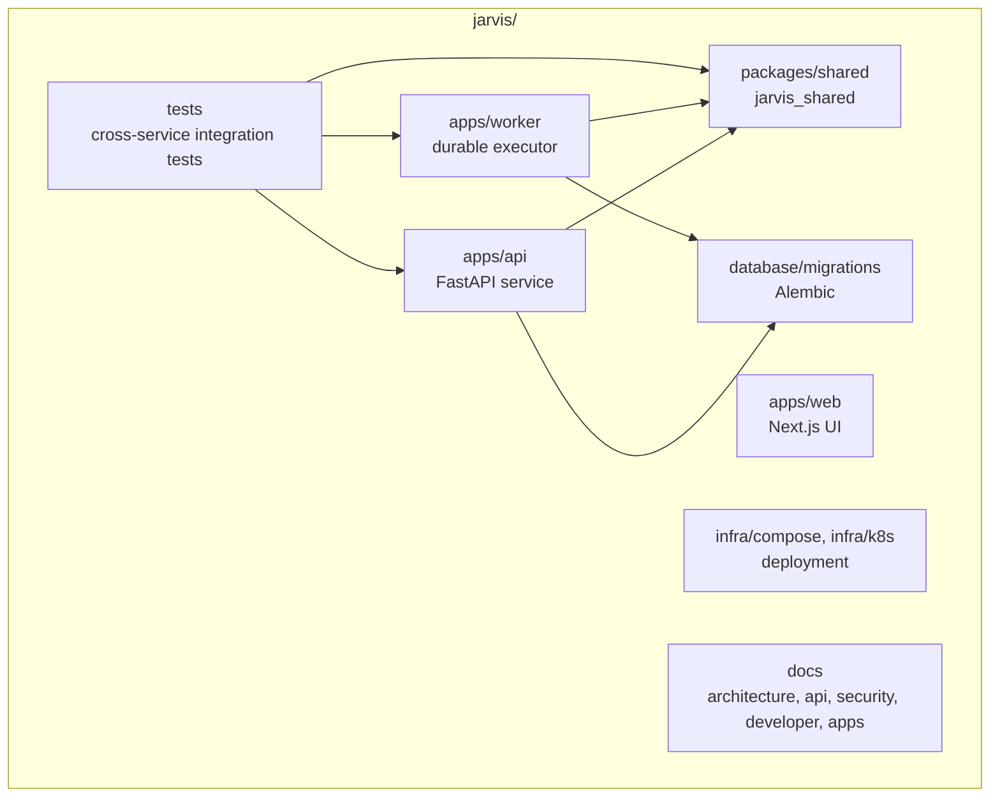

# JARVIS — Developer Guide

**Author**: Abhishek Pandey
**Last Updated**: 2026-11-16

This is the entry point for working on JARVIS day to day. For system design
and constraints, read [ARCHITECTURE.md](../architecture/ARCHITECTURE.md) first;
this guide assumes that context and focuses on where code lives and how to
change it safely.

## Repository map



No directory holds more than four files, excluding `.git`, `.venv`,
`__pycache__`, and generated build output. Modules that would exceed that cap
are Python packages (a directory with `__init__.py`), not flat files — for
example `app.db` and `app.routers.auth` are packages, not single modules. This
keeps every import path exactly what it was before the split.

## `apps/api/app`

| Package | Responsibility |
|---|---|
| `app.main` | FastAPI app construction, router registration, middleware |
| `app.config` | Settings loaded from environment variables |
| `app.db` | SQLAlchemy async engine, session factory, RLS GUC setting |
| `app.models` | ORM models — one class per table in [database.md](../architecture/database.md) |
| `app.security` | Password hashing, JWT issuance/verification, `require_user` dependency |
| `app.context` | Assembles conversation context: system prompt, preferences, memories, summary |
| `app.ai` | Provider interfaces, OpenAI implementation, the supervisor, speech |
| `app.jobs` | The durable job queue: claim, lease, heartbeat, requeue |
| `app.execution` | Runs a task step once an agent has been dispatched |
| `app.tasks_service` | Task creation, state transitions, event recording |
| `app.integrations` | OAuth connection flow and the integration step runner |
| `app.notifications` | In-app notification writes and reads |
| `app.briefing` | Daily briefing generation, consumed by the worker |
| `app.limits` | Per-account rate limiting |
| `app.observe` | `/api/v1/admin/overview` metrics |
| `app.routers.*` | One package per resource — `auth`, `conversations`, `tasks`, `assistant`, `devices`, `memory`, `voice`, `sync`, `integrations`, `notifications`, `admin` |

### `apps/api/app/ai`

| Module | Responsibility |
|---|---|
| `base` | `LanguageModel` protocol and provider error types |
| `provider_factory` | The only place that decides which provider runs; raises `NotConfigured` with no credential |
| `openai_provider` | OpenAI SDK implementation of `LanguageModel` |
| `schemas` | `Plan`, `Completion`, and related Pydantic types shared across providers |
| `supervisor` | Plans a request into steps, validates against the agent registry, forces approval on high-risk actions |
| `prompts` | System prompt templates |
| `untrusted` | Wraps retrieved content (email, web pages) as labelled, non-instructional data — the prompt-injection boundary from [SECURITY.md §1](../security/SECURITY.md) |
| `usage` | Token and estimated-cost accounting for `model_usage` |
| `speech` | Speech provider boundary; reports unconfigured status, does not invent a transcript |

### `apps/api/app/routers`

Each router package exposes one `APIRouter` and is registered in `app.main`.
Routers never query the database or call a provider directly for business
logic beyond request validation and response shaping — they delegate to
`app.tasks_service`, `app.ai.supervisor`, `app.jobs`, or the relevant service
module. This keeps HTTP concerns (status codes, request/response schemas)
separate from business rules, so the rules are reachable from both the HTTP
layer and tests without duplicating them.

Registered prefixes, from `app.main` and each router package:

| Prefix | Router package |
|---|---|
| `/api/v1/auth` | `app.routers.auth` |
| `/api/v1/conversations` | `app.routers.conversations` |
| `/api/v1/memory` | `app.routers.memory` |
| `/api/v1/tasks` | `app.routers.tasks` |
| `/api/v1/assistant` | `app.routers.assistant` |
| `/api/v1/devices` | `app.routers.devices` |
| `/api/v1/sync` | `app.routers.sync` |
| `/api/v1/voice` | `app.routers.voice` |
| `/api/v1/integrations` | `app.routers.integrations` |
| `/api/v1/notifications` | `app.routers.notifications` |
| `/api/v1/admin` | `app.routers.admin` |
| `/api/v1/health` | `app.main`, not a router package |

`CORSMiddleware` allows `http://localhost:3000` only, with credentials. The
`kind` web origin `http://localhost:3001` is not in that list. Authenticated
routes expect `Authorization: Bearer` with the user access token. The refresh
token is the HttpOnly cookie `jarvis_refresh`, path `/api/v1/auth`,
`SameSite=Lax`. `secure` is set only when `APP_ENV=production`.

Full endpoint-by-endpoint documentation: [api/conventions.md](../api/conventions.md)
and [api/conversations.md](../api/conversations.md). FastAPI also generates
interactive docs for every registered route at `/docs` (Swagger UI) and
`/redoc` on the running API — http://localhost:8000/docs in the Compose setup.

The admin route (`app.observe`) requires the `ADMIN_TOKEN` environment
variable to be set and the same value sent as an `Authorization: Bearer`
header — a signed-in user's JWT does not open it. See
[INSTALLATION.md](INSTALLATION.md#optional--operator-admin-view).

## `packages/shared/jarvis_shared`

Imports nothing from `apps/`. This is deliberate — the agent registry and task
state machine are a contract both the API and the worker depend on, and
neither should be able to introduce an API-only or worker-only assumption into
them.

| Module | Responsibility |
|---|---|
| `agents` | `AgentSpec`, `AGENTS` registry, `get_agent`, `action_allowed` |
| `tasks` | `TaskStatus`, `allowed_transitions`, `apply_transition`, `IllegalTransition` |
| `commands` | Command normalization shared by the assistant gateway and voice |
| `speech` | Locale normalization and language metadata, shared by voice and the command gateway |
| `integrations` | Provider-agnostic integration step contracts, consumed by `app.integrations.runner` |

Consumers import submodules directly (`jarvis_shared.agents`, not the package
root). `jarvis_shared/__init__.py` re-exports the task state machine and agent
registry types for convenience; it does not re-export `commands`, `speech`, or
`integrations`.

## `apps/worker`

Start it with `python -m jarvis_worker`. `jarvis_worker.loop` claims jobs
from PostgreSQL with `FOR UPDATE SKIP LOCKED`, heartbeats the lease, and
reaps expired leases. It imports `app.jobs`, `app.execution`,
`app.integrations.runner`, `app.briefing`, `app.config`, and `app.db`
directly — it runs inside the API's Python package rather than a fully
isolated service. This is a deliberate simplification tracked in
[roadmap.md](../architecture/roadmap.md): the task contract
(`jarvis_shared.tasks`) and the job table (`app.jobs`) are the real boundary
between the two processes, not a language or package boundary. The health
check listens on `127.0.0.1` and is not published off the host.

Worker knobs in `config/env/.env.example`, with the same defaults in
`app.config.Settings`. None are secrets. Compose does not pass them, so a
containerized worker keeps the code defaults unless you add them to the worker
service environment.

| Variable | Default | Effect |
|---|---|---|
| `JOB_MAX_ATTEMPTS` | `3` | Attempts before a job stops retrying |
| `JOB_BACKOFF_BASE_SECONDS` | `2` | First retry delay |
| `JOB_BACKOFF_MAX_SECONDS` | `60` | Cap on retry delay |
| `WORKER_CONCURRENCY` | `2` | Jobs claimed at once |
| `WORKER_PER_USER_MAX_RUNNING` | `1` | Running jobs per account |
| `WORKER_POLL_INTERVAL_SECONDS` | `1` | Idle poll interval |
| `WORKER_LEASE_SECONDS` | `60` | Claim lease |
| `WORKER_HEARTBEAT_SECONDS` | `15` | Lease heartbeat |
| `WORKER_SHUTDOWN_GRACE_SECONDS` | `20` | Stop grace period |
| `WORKER_HEALTH_PORT` | `8091` | Health bind port on `127.0.0.1` |

## Common changes

### Adding an API endpoint

1. Add the route to the relevant package under `app/routers/`, or create a new
   package with an `__init__.py` if it is a new resource.
2. Register the router in `app.main` if it is new.
3. Delegate business logic to a service module (`app.tasks_service`,
   `app.ai.supervisor`, etc.) rather than writing it inline in the router.
4. Document the endpoint in `docs/api/conventions.md` (for the general
   contract) or a dedicated file under `docs/api/` if the resource is large
   enough to warrant one, following the pattern in
   [api/conversations.md](../api/conversations.md).
5. Add a test under `tests/` in the directory matching the feature area
   (`tests/assistant`, `tests/security`, `tests/integrations`, etc.).

### Adding an agent

Agents are data, not classes — see
[ARCHITECTURE.md §6](../architecture/ARCHITECTURE.md#6-agent-architecture).

1. Add an `AgentSpec` entry to `jarvis_shared.agents.AGENTS`: id, description,
   capability list, permission list, timeout, retry policy.
2. Add a migration that inserts the new row into the `agents` table and its
   capabilities into `agent_capabilities` — the registry in code and the
   seeded database row must agree, because `validate_plan` checks the registry
   and the worker looks up the row for the real execution.
3. Add a handler consumed by `app.execution` if the agent needs behavior
   beyond what an existing handler provides.
4. No change to `app.ai.supervisor` or the orchestrator is needed. That is the
   point of the registry pattern.

### Adding a database migration

1. Add a new revision file under the subdirectory in
   `database/migrations/versions/` that matches the current range (see
   `apps/api/alembic.ini` for `version_locations`), or create a new
   subdirectory if the current one has reached four files.
2. Set `down_revision` to the current head. Run `alembic heads` first if
   unsure — more than one head means a branch exists and must be resolved
   before adding another revision.
3. If the table is tenant-owned (carries `user_id`), add it to the
   `FORCE ROW LEVEL SECURITY` list and write a `USING`/`WITH CHECK` policy
   matching the pattern in `0009_rls_hardening.py`. See
   [database.md §Row-level security](../architecture/database.md#row-level-security).
4. Never create or alter a table outside a migration. Nothing runs DDL at
   application startup.
5. Update `docs/architecture/database.md` with the new table or column.

### Adding a configuration value

1. Add the setting to `app.config`.
2. Add it to `config/env/.env.example` with a comment explaining what happens
   when it is unset — JARVIS reports "not configured" rather than silently
   degrading, so document that behavior rather than leaving the reader to
   infer it.
3. If it is a secret (API key, signing key, database password), never give it
   a real-looking default. A blank value in `.env.example` is correct.

## Testing

```bash
.venv/bin/python -m pytest
```

Tests are organized by feature area under `tests/`: `assistant`, `integrations`,
`jobs`, `operations`, `security`. Auth and conversation tests need PostgreSQL
running (`docker compose up -d`), because the suite exercises row-level
security and cross-tenant isolation against a real database rather than
mocking it — those are exactly the properties a mock would hide a regression
in.

Run a single feature area:

```bash
.venv/bin/python -m pytest tests/security
```

### Where to look for examples

| Need | Reference test |
|---|---|
| Cross-tenant isolation pattern | `tests/security/test_security.py` |
| Task state machine transitions | `tests/jobs/test_durable_jobs.py` |
| Worker crash recovery | `tests/jobs/test_worker_recovery.py` |
| Supervisor plan validation | `tests/assistant/test_supervisor.py` |
| Command gateway contract (`source`, `device_id`) | `tests/assistant/test_assistant.py` |
| Voice locale handling | `tests/integrations/test_voice.py` |

## Code conventions

- **FastAPI + Pydantic v2** for every request and response body. Unknown
  fields are rejected, not ignored.
- **SQLAlchemy 2.0 async** with explicit queries. No lazy-loading relationship
  traversal that could hide an unscoped query — every tenant-table query takes
  `user_id` as an explicit argument at the repository boundary.
- **No fabricated responses.** A missing credential (model provider, speech
  provider, Google OAuth) returns an explicit "not configured" error or status
  field. See the provider factory pattern in `app.ai.provider_factory` and
  reuse it rather than inventing a new form of silent fallback.
- **Risk classification is enforced in code, not in a prompt.** If you add an
  action that should require approval (send, delete, pay, purchase, deploy,
  publish, transfer), add the keyword check in `app.ai.supervisor.validate_plan`
  — see [SECURITY.md §4](../security/SECURITY.md#4-action-risk-classification).

## Where to go next

The worker process is documented in [WORKER.md](../apps/WORKER.md). The web
app is documented in [web.md](../apps/web.md).

- [ARCHITECTURE.md](../architecture/ARCHITECTURE.md) — system design, the task
  engine, memory, and deployment model.
- [SECURITY.md](../security/SECURITY.md) and
  [AUTHENTICATION.md](../security/AUTHENTICATION.md) — trust boundaries, token
  lifecycle, and authorization.
- [database.md](../architecture/database.md) — full schema and row-level
  security policy detail.
- [INSTALLATION.md](INSTALLATION.md) — local environment setup.
- [roadmap.md](../architecture/roadmap.md) — what is implemented, what is
  verified, and what remains.
