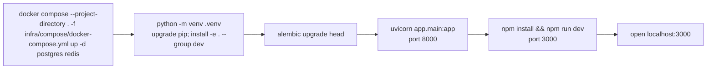
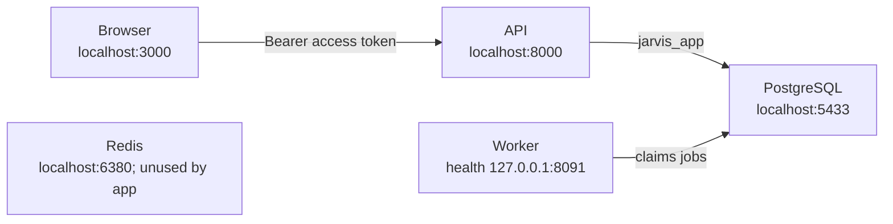
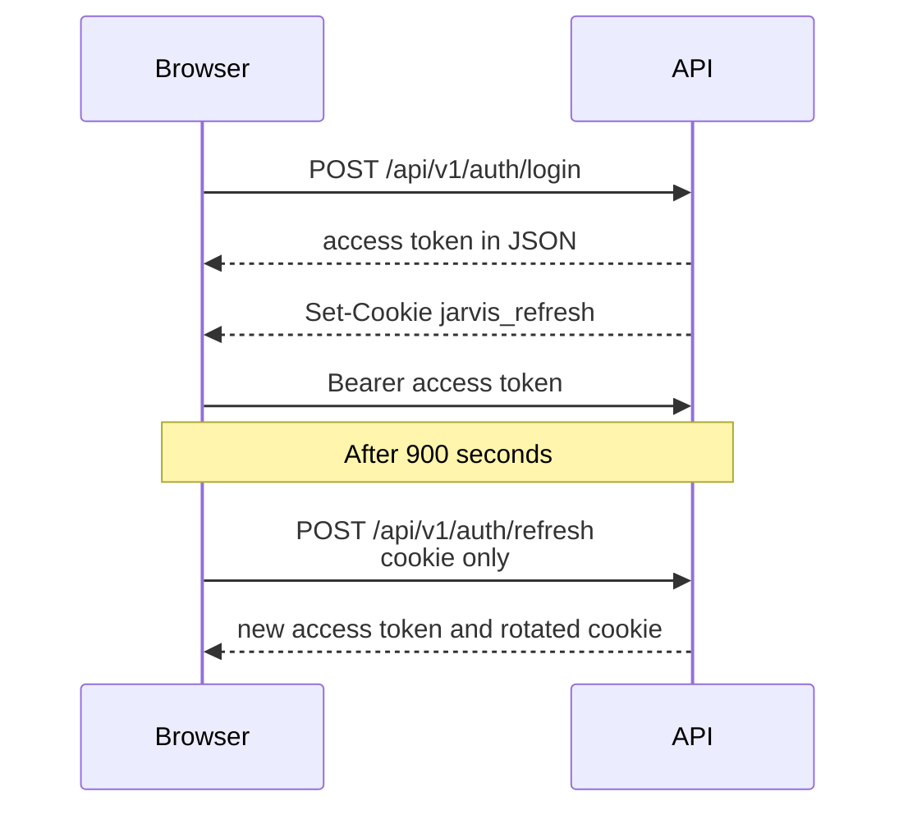
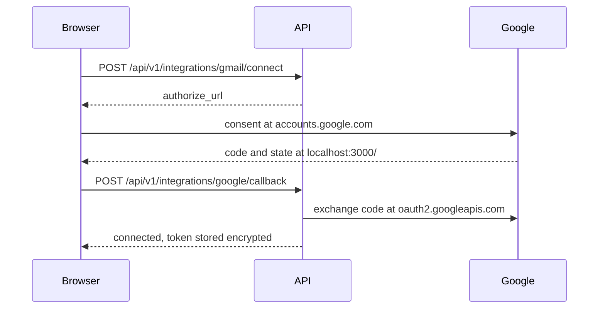
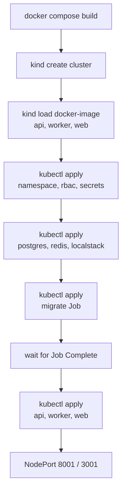

# JARVIS — Installation Guide

**Author**: Abhishek Pandey
**Last Updated**: 2026-11-16

Two supported local paths: run the API and web app against Docker Compose
data services, or run the services in a local Kubernetes cluster (`kind`).
Both use the same database migrations. Neither Compose nor the kind setup
configures TLS; both expose local HTTP endpoints and are not production TLS
configurations.

## Requirements

- Python 3.12
- Node.js 20 or newer
- Docker, for PostgreSQL. The Compose setup also starts Redis, which the
  application does not currently use.
- `kind` and `kubectl`, only for the Kubernetes path

## Path A — Docker Compose



### 1. Start the data services

```bash
docker compose --project-directory . -f infra/compose/docker-compose.yml up -d postgres redis
```

This starts only PostgreSQL (port 5433) and Redis (port 6380). The application
currently uses PostgreSQL but does not use Redis. The API, web, and worker are
started separately below, avoiding duplicate services and port conflicts.
LocalStack is optional scaffolding and is not used by the app. Ports
5433 and 6380 are used instead of the defaults because 5432 and 6379 are often
already taken on a developer machine.



The browser never talks to PostgreSQL, Redis, or the worker. Compose does not
publish the worker health port. LocalStack is optional scaffolding; this path
does not start it or use it.

### 2. Install the Python package

```bash
python3.12 -m venv .venv
.venv/bin/python -m pip install --upgrade pip
.venv/bin/pip install -e . --group dev
```

`dev` is a PEP 735 dependency group (see `[dependency-groups]` in
`pyproject.toml`), not a `pip` extra — `pip install -e ".[dev]"` does not
install it. The `--group` option requires `pip` 25.1 or newer; upgrading pip
first ensures that a fresh virtual environment supports the documented command.

### 3. Configure environment variables

```bash
cp config/env/.env.example .env
```

Edit the resulting root-level `.env`. Compose reads it for variable
interpolation; the directly run API and worker load it through `app.config`.
Never commit `.env`.

#### Required for these local steps

| Variable | What it is | Where to get it |
|---|---|---|
| `JWT_SECRET` | Signs access tokens only (JWT HS256) | Generate a strong random value with `python -c "import secrets; print(secrets.token_urlsafe(48))"` and set it explicitly in root `.env`. The app has a development fallback, so omitting this variable does not fail closed. The production guard checks only that the value has at least 32 characters; it does not check strength or uniqueness. Use a strong independent value in production. |
| `ACCESS_TOKEN_TTL_SECONDS` | Access-token lifetime | Defaults to `900` (15 minutes). Not a secret. Compose does not pass it; a containerized API keeps the code default unless you add it to the API service environment. |
| `REFRESH_TOKEN_TTL_SECONDS` | Refresh-token and cookie lifetime | Defaults to `2592000` (30 days). Not a secret. Same Compose gap as the access TTL. |
| `POSTGRES_PASSWORD` | Password for the `jarvis` owner role | The current Compose manifest sets the local owner password directly; a same-named value in `.env` alone does not override it. If changing it, update the Compose `postgres` service and `DATABASE_URL_SYNC` together. |
| `JARVIS_APP_DB_PASSWORD` | Password for the restricted `jarvis_app` runtime role used by API/worker | Compose reads it from root `.env` when creating the role during migration; updating `.env` later does not rotate an already-created role. |
| `DATABASE_URL` | Runtime PostgreSQL URL for a host-run API/worker | Read from root `.env`; it must use the `jarvis_app` role and host port `5433`. Compose constructs an in-network URL for its containers. |
| `DATABASE_URL_SYNC` | Owner-role PostgreSQL URL used by host-run Alembic migrations | Read from root `.env`; it must use the `jarvis` role and host port `5433`. |

`JWT_SECRET` does not sign refresh tokens. `app.security.new_refresh_token`
draws 48 URL-safe bytes. The database stores only the SHA-256 hex digest.
The raw value is the HttpOnly cookie `jarvis_refresh`, path `/api/v1/auth`,
`SameSite=Lax`. `secure` is true only when `APP_ENV=production`. Logout
deletes that cookie on the same path. The web app keeps the access token in
`sessionStorage` under `jarvis_access` and sends it as `Authorization: Bearer`.

The owner and runtime roles are separate for a reason — see
[database.md §Row-level security](../architecture/database.md#row-level-security).
The current Compose manifest sets the owner credentials directly; changing
`POSTGRES_PASSWORD` in `.env` alone will not update the container. For the
runtime role, changing `JARVIS_APP_DB_PASSWORD` after migration `0009` has
created the role does not rotate its existing password. Update connection
URLs and role credentials consistently; on a non-disposable database, use
your database administration process rather than deleting a volume.

The host-run API reads `DATABASE_URL` and `REDIS_URL` from root `.env`. Compose
passes in-network URLs to containerized API/worker services instead. For
host-run migrations, step 4 loads `DATABASE_URL_SYNC` from that same file.
`REDIS_URL` is not a secret in the local stack: host processes use
`redis://localhost:6380/0`; Compose and the Kubernetes Secret use
`redis://redis:6379/0`. No Redis password is configured.

`API_PUBLIC_URL` is a Settings field that defaults to `http://localhost:8000`.
Nothing in the API, worker, Compose file, or Kubernetes manifests reads it.
Do not treat it as a live endpoint. `APP_ENV` defaults to `development`.
`production` turns the refresh cookie `Secure` flag on and refuses to start
if `JWT_SECRET` is shorter than 32 characters. It does not validate secret
strength or uniqueness, and the development fallback means an unset value does
not fail closed. Set an independent strong random `JWT_SECRET` explicitly in
production. `LOG_LEVEL` defaults to `INFO`.

Account creation is `POST /api/v1/auth/register`. Sign-in is
`POST /api/v1/auth/login`. Both take JSON `email` (3–254 characters) and
`password` (8–128 characters). Register may also take `display_name` (max 80).
Refresh is `POST /api/v1/auth/refresh` and reads only the cookie. Logout is
`POST /api/v1/auth/logout` and also requires the Bearer access token.
Login is limited to 8 attempts per client IP in 300 seconds, in memory only;
an API restart clears that counter. Password change is
`POST /api/v1/auth/password` and revokes every session. Account deletion is
`DELETE /api/v1/auth/account` and marks the account deleted; it does not erase
rows. Neither route is exposed as a button in the current web UI.



The refresh cookie is HttpOnly, path `/api/v1/auth`, `SameSite=Lax`. `Secure` is
on only when `APP_ENV=production`. The access token is not that cookie.

#### Optional — AI model provider

Without this, JARVIS starts normally and reports `"configured": false` from
`/api/v1/health`; chat replies return 503 `ai_not_configured` instead of
fabricating an answer — see
[Configure a model](../../README.md#configure-a-model) in the root README.

| Variable | What it is | Where to get it |
|---|---|---|
| `OPENAI_API_KEY` | OpenAI API credential | https://platform.openai.com/api-keys |
| `OPENAI_BASE_URL` | API base URL | Defaults to `https://api.openai.com/v1`; override only for an OpenAI-compatible endpoint |
| `OPENAI_MODEL` | Model name | Defaults to `gpt-4o-mini` in `config/env/.env.example` and `app.config.Settings` |
| `LLM_API_KEY` | Older alias for the same credential | Not in `.env.example`. `app.config.Settings.resolved_api_key` uses `OPENAI_API_KEY` first, then this value. Set one, not both |
| `LLM_MODEL` | Older alias for the model name | Not in `.env.example`. `resolved_model` prefers this value over `OPENAI_MODEL` when it is set. |

The Compose API service forwards `OPENAI_API_KEY` but does not currently pass
custom `AI_PROVIDER`, `OPENAI_BASE_URL`, or `OPENAI_MODEL` values. Those
settings take effect for a directly run API process that reads root `.env`;
for Compose, add the desired variables to the API service environment in
`infra/compose/docker-compose.yml`. The legacy `LLM_*` aliases are not passed
by Compose either. `STT_PROVIDER` and `TTS_PROVIDER` are blank optional
settings; the current voice flow uses browser speech capture/synthesis, and
the repository does not specify server speech-vendor credentials.

#### Optional — Google OAuth (Gmail / Calendar integrations)

Without both values set, `/api/v1/integrations` reports the Google provider
as not configured and `POST /api/v1/integrations/{provider}/connect` returns
503 `integration_not_configured` — see `apps/api/app/integrations/google/__init__.py`.
Connecting an integration also requires `FERNET_KEY` in root `.env`, since
tokens are refused rather than stored unencrypted. Generate it locally with
`python -c "from cryptography.fernet import Fernet; print(Fernet.generate_key().decode())"`.
`FERNET_KEY` is optional if you do not connect an integration.

| Variable | What it is | Where to get it |
|---|---|---|
| `GOOGLE_CLIENT_ID` | OAuth 2.0 client ID | Google Cloud Console → APIs & Services → Credentials: https://console.cloud.google.com/apis/credentials |
| `GOOGLE_CLIENT_SECRET` | OAuth 2.0 client secret | Same Credentials page, generated alongside the client ID |
| `GOOGLE_REDIRECT_URI` | Where Google redirects the browser after consent | Defaults to `http://localhost:3000/`. This exact URI must be registered as an "Authorized redirect URI" on the Google OAuth client, or Google refuses the request. The redirect lands on the web app, not the API — the web app then posts the code to the API. Compose does not pass this variable; a containerized API keeps the code default unless you add it to the API service environment. |

The consent URL is built locally at
`https://accounts.google.com/o/oauth2/v2/auth`. Token exchange uses
`https://oauth2.googleapis.com/token`. Scopes come from
`packages/shared/jarvis_shared/integrations/__init__.py` and are not
environment variables:

| Provider id | Scope |
|---|---|
| `gmail` | `https://www.googleapis.com/auth/gmail.readonly` |
| `google_calendar` | `https://www.googleapis.com/auth/calendar.readonly` |

Enable those APIs on the same Google Cloud project as the OAuth client.
Read calls use `https://gmail.googleapis.com/gmail/v1/users/me/profile` and
`https://www.googleapis.com/calendar/v3/users/me/calendarList`. Sending mail
and writing calendar events are not in these scopes.



`google_calendar` uses the same callback. The state is single-use and bound to
the account that started the connect call. A second account posting that state
gets 400.

#### Optional — operator admin view

| Variable | What it is | Where to get it |
|---|---|---|
| `ADMIN_TOKEN` | Bearer token that opens `/api/v1/admin/overview` (queue depth and usage totals only — never conversation content) | Generate locally: `python -c "import secrets; print(secrets.token_urlsafe(48))"`. Leave blank to keep the route closed — a user JWT does not open it regardless. |

#### Browser API URL

The web app does not read root `.env`. `apps/web/lib/api.ts` defaults
`NEXT_PUBLIC_API_URL` to `http://localhost:8000`; the Compose web image also
embeds that URL at build time. `npm run dev` uses the same API default unless
you export `NEXT_PUBLIC_API_URL` before starting Next. The browser requests the
API directly — there is no same-origin API proxy. The page CSP in
`apps/web/next.config.ts` allows `connect-src` only to `'self'` and
`http://localhost:8000`.

The current `kind` manifests expose API at port 8001, but the checked-in web
CSP does not allow that origin and the web image's default API URL still points
to port 8000. Therefore, `kind` currently verifies the deployed services and
API endpoints, but its web page cannot use the Kubernetes API end to end
without changing the web CSP and rebuilding with
`NEXT_PUBLIC_API_URL=http://localhost:8001`. This guide does not claim the
current `kind` web UI is functional against the `kind` API.

#### LocalStack (no credential needed)

`infra/compose/docker-compose.yml` sets dummy LocalStack credentials
(`AWS_ACCESS_KEY_ID=test`, `AWS_SECRET_ACCESS_KEY=test`). Nothing in the
application calls LocalStack yet — it is scaffolding for a future
object-storage feature. No action needed.

### 4. Run database migrations

Load the owner connection URL from root `.env`, then run Alembic:

```bash
set -a
. ./.env
set +a
.venv/bin/alembic -c apps/api/alembic.ini upgrade head
```

Migrations run as the table-owner role (`jarvis`). The application connects as
a separate, more restricted role (`jarvis_app`) so PostgreSQL enforces
row-level security — see [database.md](../architecture/database.md#row-level-security).

### 5. Start the API

```bash
.venv/bin/uvicorn app.main:app --app-dir apps/api --port 8000
```

Confirm it is up:

```bash
curl -s http://localhost:8000/api/v1/health
```

### 6. Start the web app

In a second terminal:

```bash
cd apps/web
npm install
npm run dev
```

Open http://localhost:3000.

### 7. Start the worker (optional for manual testing)

Durable task execution needs the worker running. Without it, tasks are
created and queued but never claimed.

```bash
.venv/bin/python -m jarvis_worker
```

The process claims jobs with `FOR UPDATE SKIP LOCKED`, heartbeats the lease,
and reaps expired leases. A health check listens on `127.0.0.1:8091` by default
(override with `WORKER_HEALTH_PORT`) and reports process status, database
reachability, queue depth, and in-flight jobs. When the worker runs directly
on the host, it is available at `http://127.0.0.1:8091/`; when containerized,
it is not published outside the worker container.

## Path B — Local Kubernetes (`kind`)



Build the images first, then create the cluster and apply manifests in
dependency order:

```bash
docker compose --project-directory . -f infra/compose/docker-compose.yml build

kind create cluster --name jarvis --config infra/k8s/base/kind-config.yaml
kind load docker-image jarvis-api:local jarvis-worker:local jarvis-web:local --name jarvis

kubectl apply -f infra/k8s/base/namespace.yaml -f infra/k8s/base/rbac.yaml
# Apply Secret objects from local-only, untracked manifests or approved injection.
kubectl apply -f infra/k8s/data/
kubectl apply -f infra/k8s/base/migrate-job.yaml
kubectl -n jarvis wait --for=condition=Complete job/migrate --timeout=180s
kubectl apply -f infra/k8s/app/
kubectl -n jarvis wait --for=condition=Available deployment/api deployment/worker deployment/web --timeout=240s
```

The `kind` config maps NodePorts to host ports 8001 (API) and 3001 (web),
distinct from the Compose ports above so both stacks can run at once. The
migrate Job must reach `Complete` before `api` and `worker` start; both
deployments carry an init container that waits on it.

#### Kubernetes credentials

`kubectl apply` does not read root `.env`. Provide the required Secret objects
through local-only, untracked manifests or an approved secret-injection
process; do not put populated secret values in Git or commit them. Use the
listed keys as a reference when preparing local credentials. Kubernetes Secret
`data` fields are base64-encoded, not encrypted. Kubernetes does not encrypt
Secrets in etcd by default unless encryption at rest is configured. See the
[Kubernetes Secret documentation](https://kubernetes.io/docs/concepts/configuration/secret/).
Do not use these manifests as production secret management.

| Manifest | Secret keys to configure |
|---|---|
| `infra/k8s/secrets/data/secret-postgres.yaml` | `POSTGRES_USER`, `POSTGRES_DB`, `POSTGRES_PASSWORD` |
| `infra/k8s/secrets/data/secret-migrate.yaml` | `DATABASE_URL_SYNC`, `JARVIS_APP_DB_PASSWORD` |
| `infra/k8s/secrets/app/secret-api.yaml` | `ADMIN_TOKEN`, `DATABASE_URL`, `FERNET_KEY`, `GOOGLE_CLIENT_ID`, `GOOGLE_CLIENT_SECRET`, `JWT_SECRET`, `OPENAI_API_KEY`, `REDIS_URL` |
| `infra/k8s/secrets/app/secret-worker.yaml` | `DATABASE_URL`, `FERNET_KEY`, `OPENAI_API_KEY`, `REDIS_URL` |
| `infra/k8s/secrets/data/secret-localstack.yaml` | LocalStack-only dummy AWS credentials and service settings; no real AWS credential is needed |

Use PostgreSQL and Redis service addresses reachable inside the `jarvis`
namespace for the Kubernetes connection URLs. Do not copy the host-run `.env`
URLs unchanged: their `localhost` addresses and published ports are for
processes running on the host. Keep the owner/runtime database passwords
aligned with the corresponding connection URLs.

The Kubernetes API currently defaults Google OAuth redirects to
`http://localhost:3000/`, but the `kind` web NodePort is 3001. If enabling
Google OAuth on `kind`, set `GOOGLE_REDIRECT_URI` on the API Deployment to
`http://localhost:3001/` and register that exact URI in Google Cloud Console.
The current web CSP and API URL build default also prevent the browser from
using the Kubernetes API; see [Browser API URL](#browser-api-url).

LocalStack has no NodePort. Reach it with:

```bash
kubectl -n jarvis port-forward svc/localstack 4566:4566
```

Manual verification URLs and a disposable test account are in
[evidence/runs/local-deploy-20261116/local-verification-urls.txt](../../evidence/runs/local-deploy-20261116/local-verification-urls.txt).

## URLs at a glance

| Service | Compose URL | `kind` (Kubernetes) URL |
|---|---|---|
| Web app | http://localhost:3000 | http://localhost:3001 |
| API | http://localhost:8000 | http://localhost:8001 |
| API health check | http://localhost:8000/api/v1/health | http://localhost:8001/api/v1/health |
| API interactive docs (Swagger UI) | http://localhost:8000/docs | http://localhost:8001/docs |
| API alternate docs (ReDoc) | http://localhost:8000/redoc | http://localhost:8001/redoc |
| Admin overview (needs `ADMIN_TOKEN` as a Bearer token) | http://localhost:8000/api/v1/admin/overview | http://localhost:8001/api/v1/admin/overview |
| PostgreSQL (host-side, for `psql`/`alembic`) | `localhost:5433` | not exposed; only reachable from the worker/API containers in-cluster |
| Redis (host-side) | `localhost:6380` | not exposed; only reachable from the worker/API containers in-cluster |
| LocalStack (optional; start separately) | http://localhost:4566 | not exposed by default; use `kubectl -n jarvis port-forward svc/localstack 4566:4566` |
| LocalStack health check | http://localhost:4566/_localstack/health | same, after port-forwarding |
| Worker health check (binds `127.0.0.1:8091` by default) | `http://127.0.0.1:8091/` when the worker runs directly on the host; not published by Compose containers | not published outside the worker container |
| Google Cloud Console (to create OAuth credentials) | https://console.cloud.google.com/apis/credentials | same |
| OpenAI API keys page | https://platform.openai.com/api-keys | same |

The API and web app URLs differ between Compose and `kind` by design — see
[Path B — Local Kubernetes (`kind`)](#path-b--local-kubernetes-kind) above —
so both stacks can run at the same time without a port conflict. In `kind`,
the API endpoint is reachable directly on port 8001, but the checked-in web
CSP only permits port 8000; the web UI cannot currently complete authenticated
API workflows against the Kubernetes API without a code configuration change
and rebuild.

## Verifying the install

```bash
curl -s http://localhost:8000/api/v1/health
```

Expect `"status":"ok"`. This endpoint reports API status and model/speech
configuration; it does not check database connectivity or worker health.
`"ai":{"configured":false,...}` is correct and expected without
`OPENAI_API_KEY` — see [ARCHITECTURE.md §4](../architecture/ARCHITECTURE.md#4-backend).

To confirm the admin route (optional, only if `ADMIN_TOKEN` is set):

```bash
curl -s -H "Authorization: Bearer $ADMIN_TOKEN" http://localhost:8000/api/v1/admin/overview
```

## Troubleshooting

| Symptom | Cause | Fix |
|---|---|---|
| `alembic upgrade head` fails to connect | PostgreSQL not up yet, or wrong port | Confirm `docker compose --project-directory . -f infra/compose/docker-compose.yml ps` shows `postgres` healthy on 5433 |
| API starts but a database-backed route returns 500 | Migrations not applied | Run step 4 before step 5 |
| `jarvis_app` role error on insert | `JARVIS_APP_DB_PASSWORD` differs from the password on the already-created role | Changing `.env` alone does not rotate an existing role; use your database administration process to rotate it, or reset only a disposable local database after confirming its data can be discarded |
| `kind create cluster` fails with "port is already allocated" | Another process already holds a mapped host port | `kind-config.yaml` maps to 8001/3001 instead of Compose ports; confirm no other process holds those |
| Pods stuck `Init:ImagePullBackOff` | Images not loaded into the `kind` node | Re-run `kind load docker-image` for the three app images |
| Google OAuth connect returns `integration_not_configured` | `GOOGLE_CLIENT_ID`/`GOOGLE_CLIENT_SECRET` unset, or `FERNET_KEY` unset | Set all three in `.env` and restart the API |
| Google redirects back with an error, or the consent screen rejects the client | `GOOGLE_REDIRECT_URI` does not exactly match the URI registered on the Google OAuth client | Confirm both are identical, including trailing slash |
| `/api/v1/admin/overview` returns 401 | `ADMIN_TOKEN` unset, or the `Authorization: Bearer` value does not match it exactly | Set `ADMIN_TOKEN` and pass the same value as the bearer token — a user JWT never opens this route |

The worker's own health check (`WORKER_HEALTH_PORT`, default `8091`) binds to
`127.0.0.1` inside its container and is not reachable from the host or from a
Compose-network probe by design — only the container's own `HEALTHCHECK`
directive can reach it. There is no host URL for it.
