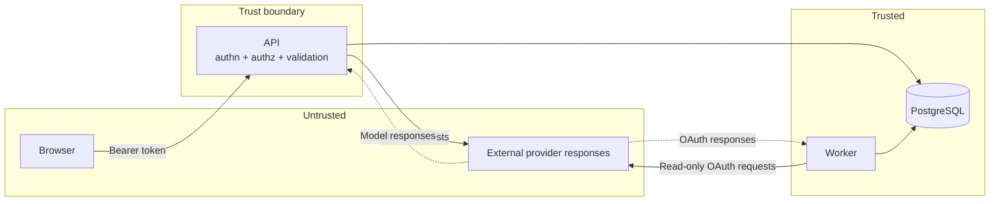

# JARVIS — Security Model

**Author**: Abhishek Pandey
**Last Updated**: 2026-11-22

This document separates implemented controls from known gaps. Deployment
configuration can add protections, but they are not assumed here.

## 1. Trust boundaries

User-supplied text, stored memories and summaries, model output, and any
external-provider response must be treated as data, not authority. The context
builder currently wraps memories and conversation summaries before sending
them to a model. Google integration code reads Gmail profile totals and
Calendar list metadata; it does not retrieve email bodies, web pages, or
documents. This does not replace server-side authorization or a completed
approval workflow; see the limitations below.

## 2. Authentication

| Token | Lifetime | Storage | Purpose |
|---|---|---|---|
| Access token (JWT, HS256) | 900 seconds | Browser `sessionStorage`; sent as a Bearer token | Authorizes API calls |
| Refresh token (opaque, random) | 30 days | HttpOnly, SameSite=Lax cookie at `/api/v1/auth` | Issues new access tokens |

The refresh cookie's Secure flag is enabled only when `APP_ENV=production`.
The database stores the refresh-token SHA-256 hash. Refresh tokens rotate on
use; reuse of a replaced token revokes its session family. Passwords use
Argon2id, and password changes revoke all sessions. The web client does not
automatically refresh or retry a request after access-token expiry.

**Production blocker — `JWT_SECRET`:** configuration has a long development
fallback. Production startup checks only that the effective secret is at least
32 characters, so an unset variable uses the fallback and passes the check.
Production does not fail closed when `JWT_SECRET` is missing. Configure a
unique secret before running in production. See
`apps/api/app/config/__init__.py` and `apps/api/app/main/__init__.py`.

## 3. Authorization and approval

User-owned access is checked in route handlers, but there is no repository
layer guarantee: router handlers include direct SQL. Do not treat a repository
abstraction as a universal user-scoping control.

When a plan requires approval, the task is stored with status
`waiting_for_approval` and no job is created. There is no approve or reject
endpoint, and exact-payload approval is not implemented. `waiting_for_approval`
has no `expires_at` and is not expired. A waiting status is
not a completed user-approval workflow.

`/api/v1/admin/overview` exists behind `ADMIN_TOKEN`. It is an operator
endpoint; there is no admin user role or admin dashboard.

Sources: `apps/api/app/routers/tasks/__init__.py`,
`apps/api/app/tasks_service/__init__.py`, `apps/api/app/routers/admin/__init__.py`,
and `apps/api/app/security/__init__.py`.

## 4. Row-level security

Migration `0009` creates non-owner runtime role `jarvis_app` and forces RLS on
these tenant tables only: `tasks`, `conversations`, `messages`, `memories`,
`jobs`, `idempotency_keys`, `devices`, `sync_events`, `integrations`,
`oauth_states`, `notifications`, `automations`, `task_steps`, and `task_events`.

RLS is not enabled on `users`, `sessions`, `user_preferences`, `agents`,
`agent_capabilities`, `audit_logs`, or `model_usage`. Handler-level query
scoping and RLS coverage must be assessed separately; neither is an all-tables
guarantee.

Source: `database/migrations/versions/revisions_0007_0009/0009_rls_hardening.py`.

## 5. Credentials, encryption, and logs

Fernet encryption applies to stored Google integration tokens only. OpenAI and
other provider credentials are environment configuration, not database
credentials encrypted with Fernet. `.env.example` contains local sample values;
it is not placeholders-only and is not production configuration.

The API logger redacts selected named context fields, but does not filter
message strings or exception text. The worker writes JSON fields directly and
does not apply the API context-field redaction. Do not assume all user data is
excluded from logs or that every request has a logged request ID.

Sources: `apps/api/app/integrations/crypto/__init__.py`,
`apps/api/app/config/__init__.py`, `apps/api/app/logging/__init__.py`, and
`apps/worker/jarvis_worker/loop.py`.

## 6. Input validation and rate limits

`TaskIn` rejects selected server-owned fields, then uses `extra="ignore"`;
unknown fields are not universally rejected across request bodies.

Login and registration are each limited to eight attempts per client IP in
five minutes, using separate in-process counters. There is no per-user login
or registration throttle, and refresh does not use this limiter. Selected task
and assistant write routes, including the realtime tool route, have an
in-process per-user limit of 30 requests per minute. The counters live in
process memory. They are not backed by Redis or a shared table, and they are
not shared across processes.

Sources: `apps/api/app/routers/tasks/__init__.py`,
`apps/api/app/routers/auth/__init__.py`, and `apps/api/app/limits/__init__.py`.

## 7. Transport security

The Compose and Kubernetes manifests do not establish TLS termination. TLS is
deployment-specific, and production TLS status remains outstanding. The refresh
cookie's Secure flag is enabled only when `APP_ENV=production`; that setting
does not itself provide TLS.

## 8. High-priority gaps

- **JWT signing secret:** an unset production `JWT_SECRET` uses the development
  fallback and passes the minimum-length startup check. This is a
  production-blocking code/config risk.
- **Approval workflow:** waiting tasks have no approve/reject endpoint or
  exact-payload approval implementation. `waiting_for_approval` has no `expires_at` and is not expired.
- **Data access:** RLS applies only to the specified tenant tables; there is no
  repository guarantee, and route handlers include direct SQL.
- **Logging and rate limits:** redaction and counters are limited to the
  behaviors described above; they are not universal or distributed controls.
- **Transport:** configure and verify TLS termination in the target deployment.
