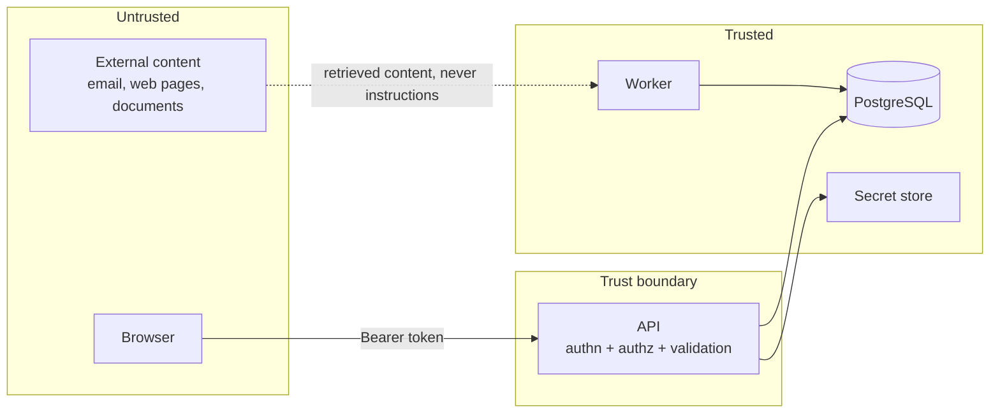

# JARVIS — Security Model

**Author**: Abhishek Pandey
**Last Updated**: 2026-11-16

Security boundaries are defined before features, so every later phase inherits
them instead of retrofitting them.

## 1. Trust boundaries

Content retrieved from email, web pages, and documents is **data**, never
instructions. It is wrapped and labelled as untrusted before it reaches a
model, and it cannot alter tool permissions, approval requirements, or system
policy. This is the prompt-injection boundary, and it is enforced in code
rather than in a prompt.

## 2. Authentication

| Token | Lifetime | Storage | Purpose |
|---|---|---|---|
| Access token (JWT, HS256) | 15 minutes | Memory only, never localStorage | Authorizes API calls |
| Refresh token (opaque, random) | 30 days | HttpOnly, Secure, SameSite=Lax cookie | Issues new access tokens |

- Refresh tokens are stored as a SHA-256 hash. The raw token exists only in the
  cookie.
- Refresh tokens rotate on every use. Reuse of a rotated token revokes the
  entire session family — that pattern means the token was stolen.
- Sessions can be revoked individually. Revocation is checked against the
  database, so a stolen access token dies within its 15-minute lifetime and a
  stolen refresh token dies immediately.
- Passwords are hashed with Argon2id.

## 3. Authorization

Two layers, both required.

**Role.** `owner` of the account sees everything that belongs to them. There is
no admin role in Phase 1; an observability dashboard comes later and will have
its own, separate authentication.

**Agent permission.** Each agent declares the operations it may perform. The
orchestrator checks the declaration before dispatching a step. An agent cannot
gain a permission at runtime, and retrieved content cannot grant one.

## 4. Action risk classification

| Risk | Examples | Gate |
|---|---|---|
| LOW | Read, summarize, search, draft | Executes, recorded in the audit log |
| MEDIUM | Create a calendar event, edit a cloud document, organize files | Executes, user is notified |
| HIGH | Send email, delete a document, move money, change permissions, publish or deploy code | Blocked until the user approves the exact action |

Approval binds to the hash of the action payload. If the payload changes after
approval, the approval is void and the step returns to `WAITING_FOR_APPROVAL`.

## 5. Data protection

- **Per-user isolation.** Every table carrying user data has `user_id`, a
  foreign key, and an index. Repository methods require `user_id` and will not
  build a query without it. PostgreSQL row-level security is enabled on those
  tables as a second barrier.
- **Secrets.** Integration tokens and provider credentials are encrypted with
  Fernet before they touch the database. The encryption key lives in the
  environment, never in the database and never in the frontend.
- **Logs.** Structured logs carry request IDs and task IDs. They do not carry
  message content, memory content, tokens, or email addresses. A logging filter
  enforces this rather than relying on discipline.
- **Transport.** TLS terminates at the reverse proxy. Cookies are `Secure`.

## 6. Input validation

- Every request body is a Pydantic model. Unknown fields are rejected.
- String fields have explicit maximum lengths.
- Identifiers are UUIDs, validated before any query.
- Rate limiting is applied per user and per IP on authentication endpoints.

## 7. Threats addressed in Phase 1

| Threat | Mitigation | Phase |
|---|---|---|
| Stolen access token | 15-minute expiry, server-side session revocation | 1 |
| Stolen refresh token | Rotation with family-wide revocation on reuse | 1 |
| Cross-user data access | Mandatory `user_id` scoping + row-level security | 1 |
| Credential in source control | `.env` gitignored, `.env.example` has placeholders only | 1 |
| Secret in logs | Logging filter, tested | 1 |
| Prompt injection via retrieved content | Untrusted-content wrapping, no permission escalation | 5 |
| CSRF | SameSite cookies, no state-changing GET | 1 |
| XSS | React escaping, no `dangerouslySetInnerHTML`, CSP header | 3 |

## 8. Known limitations

- JWT signing uses a shared secret (HS256) in Phase 1. Asymmetric signing
  (RS256) is deferred until more than one service must verify tokens.
- Row-level security depends on the application setting the session user. The
  repository layer is the primary control; RLS is defense in depth, and a test
  verifies both.
- Encryption at rest for the database volume depends on the hosting provider
  and is a deployment concern, not an application one. Tracked for Phase 12.
